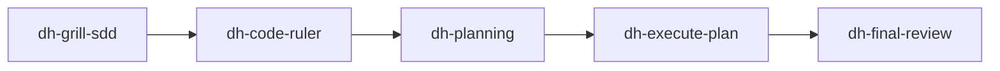

# Demo Project

Demo folder that links the `dev-harness-skills` plugin: run it isolated and
exercise the bundled harness (7 agents, 17 skills, and the project-scope `dh`
MCP server tools).

## Quickstart

```bash
cd demo-project
./demo.sh          # opencode TUI with the plugin loaded
./demo.sh validate # version + config + agents + MCP connectivity + in-process gate
```

> Note: opencode v2.0.18 does not load directory/local plugins (documented
> host limitation) — `validate` reports the load status transparently and
> gates plugin behavior via the harness test suite (181 tests, in-process
> registration of the 7 agents / 17 skills; the tools come from the `dh` MCP
> server wired in `opencode.jsonc`).

## How it is wired

1. `opencode.jsonc` — `"plugins": ["../"]` links the parent repo (plugin
   package directory form, per the v2 loading contract).
2. `opencode.jsonc` — `mcp.servers.dh` wires the project-scope MCP server with
   the LOCAL build: `["node", "../dist/mcp/stdio.js"]` (run `pnpm build` in the
   repo first). Shipped projects use the npx form (see README / docs/LOADING.md).
   `validate` step 4/5 connects through it on a fresh data dir.
3. `.obsidian/` — the project root IS an Obsidian vault (dh-setup mandate),
   so `notesmd-cli search-content "..." --vault "demo-project"` works.
4. `docs/` — every generated document follows the documentation contract:
   markdown primary, csv/json/yaml/xml complementary, mermaid for workflows,
   ASCII wireframes for UI, obsidian frontmatter.

## Example workflow (plugin usage)



## Demo UI (ASCII wireframe)

```
+--------------------------------------------------+
| demo-project          [sdd] [plan] [review] [docs]|
+--------------------------------------------------+
|  Harness loaded: 7 agents / 17 skills / dh MCP   |
|  Try:  ask dh-software-architect to plan a task   |
+--------------------------------------------------+
```

## Tabular data demo

`docs/data/people.csv` is queryable through the `dh` MCP server's DuckDB tools:

```
dh_read_sheet { path: "demo-project/docs/data/people.csv", query: "SELECT name FROM read_csv_auto(?) WHERE age > 30" }
```