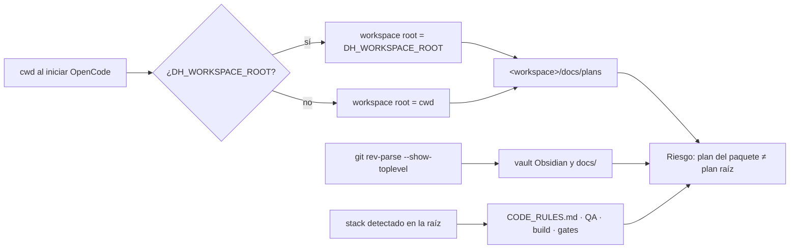

# Auditoría: skills y agentes en standalone vs monorepo anidado

Auditoría de los **26 skills** y **5 agentes** del harness frente a dos escenarios: un proyecto standalone (una sola raíz) y un monorepo con proyectos standalone anidados. La evidencia de skills se cita relativa a `skills/` y la de agentes relativa a `agents/`; los números de línea corresponden a la revisión auditada.

## Veredicto

- **Standalone:** el harness está diseñado para un único `project root = cwd`; funciona cuando `dh-setup` se ejecuta en la raíz y OpenCode arranca allí.
- **Monorepo con proyectos standalone anidados:** funciona de forma accidental solo si se arranca en la raíz del workspace y los comandos de la raíz agregan todos los paquetes. No existe concepto de workspace, paquete ni proyecto anidado; todo se resuelve vía `{project_root}`, `./docs/plans`, `git rev-parse --show-toplevel`, `$PWD` y detección de stack en la raíz.
- **Riesgo principal:** el anclaje del workspace (`cwd` vs `DH_WORKSPACE_ROOT` vs git root) puede dividir planes, docs, reglas y gates entre la raíz del monorepo y el paquete donde arrancó OpenCode.

### Modelo de anclaje actual

## Comportamiento standalone

Con una sola raíz, el harness opera de forma coherente:

- Planes, SDD, reviews y diagramas viven bajo `./docs/plans`.
- `dh-setup` configura hooks, QA, MCP, `AGENTS.md` y `docs`.
- `dh-coding` y `dh-code-ruler` usan el stack de la raíz y `CODE_RULES.md`.
- `dh-preflight` y `dh-artifact-check` ejecutan el toolchain de la raíz.
- `dh-create-documentation` usa como vault el git root.
- Las reviews ven el diff completo.
- `dh-create-worktree` lee el `WORKTREE_LIFECYCLE.md` de la raíz.

## Matriz de skills (26)

Convenciones: **Raíz** = cwd en la raíz del monorepo; **Paquete** = cwd en un proyecto anidado. El comportamiento se deriva de los contratos citados; la columna **Gap** remite a la evidencia de [Gaps priorizados](#gaps-priorizados).

### Planes y ejecución (10)

| Skill | Standalone | Monorepo (cwd = raíz) | Paquete anidado (cwd = paquete) | Gap |
|---|---|---|---|---|
| `dh-planning` | Crea el plan en `./docs/plans/<slug>/plan.md`. | Funciona: un plan en la raíz. | Escribe `./docs/plans` dentro del paquete; el plan queda fuera del plan raíz. | P0 anclaje — `dh-planning/SKILL.md:13` |
| `dh-grill-sdd` | Genera el SDD junto al plan. | Funciona. | SDD en el paquete, no en la raíz. | P0 anclaje (`./docs/plans`) |
| `dh-domain-check` | Mapea contextos por directorios de primer nivel. | Ve los directorios de la raíz, no los paquetes como contextos. | Ve el paquete actual. | P2 — `dh-domain-check/SKILL.md:47-53` |
| `dh-contingency` | Escribe `contingency.md` bajo `./docs/plans/<slug>/`. | Funciona. | Escribe en el paquete. | P0 anclaje (`./docs/plans`) |
| `dh-execute-plan` | Itera el plan de la raíz; solo alinea ramas de submódulos. | Funciona para un plan raíz. | Ejecuta el plan del paquete; sin concepto de workspace. | P1 — `dh-execute-plan/SKILL.md:20` |
| `dh-execute-plan-fast` | Igual, desde `plan_fast.md`. | Funciona. | Mirror fast y gates finales a nivel paquete. | P1 — `dh-execute-plan-fast/SKILL.md:32` |
| `dh-execute-plan-task` | Usa stack y reglas de la raíz. | Un solo stack/`CODE_RULES.md` para todo el monorepo. | Detecta el stack del paquete, pero las reglas se resuelven en la raíz. | P0 — `dh-execute-plan-task/SKILL.md:33-42` |
| `dh-execute-plan-task-fast` | Igual, sin gates por tarea. | Igual: stack y reglas únicos. | Igual: ejecución de paquete con contrato de raíz única. | P0 — mismo contrato single-root |
| `dh-pause-plan` | Handoff en `./docs/plans/<slug>/handoff.md` con estado git/fingerprint repo-wide. | Funciona; snapshot de todo el repo. | Handoff del paquete con estado git de todo el repo. | P2 — `dh-pause-plan/SKILL.md:103-120` |
| `dh-resume-plan` | Valida handoff y drift con fingerprint repo-wide. | Funciona. | El drift del repo puede mezclar cambios de otros paquetes. | P2 — `dh-resume-plan/SKILL.md:93-96` |

### Review y entrega (8)

| Skill | Standalone | Monorepo (cwd = raíz) | Paquete anidado (cwd = paquete) | Gap |
|---|---|---|---|---|
| `dh-review` | Revisa el sub-task y escribe `tasks/review.md` bajo `./docs/plans`. | Revisa el diff completo del repo. | Plan/review en el paquete; diff no acotado por paquete. | P1 — `dh-review/SKILL.md:19` |
| `dh-code-review` | Revisa el código cambiado. | Diff de todo el repo. | Sin filtro por ruta de paquete. | P1 — `dh-code-review/SKILL.md:17` |
| `dh-simplify` | Revisa y corrige el código cambiado. | Alcance repo-wide. | Sin alcance por paquete. | P1 — `dh-simplify/SKILL.md:19` |
| `dh-final-review` | Diff completo vs `sdd.md` y gates de release. | Funciona con el plan raíz. | Plan y diff del paquete; gates de release únicos. | P1 — `dh-final-review/SKILL.md:55` |
| `dh-preflight` | Ejecuta el toolchain de la raíz. | Un solo toolchain para todo el workspace. | Ejecuta el toolchain del paquete, sin matriz ni agregación. | P1 — `dh-preflight/SKILL.md:16-22` |
| `dh-artifact-check` | Build/deploy de la raíz. | Un solo build/deploy. | Build/deploy del paquete, sin per-package/filter/aggregate. | P1 — `dh-artifact-check/SKILL.md:16-23` |
| `dh-semver` | Un tag/versión por repo. | Un tag para todo el monorepo. | Tag calculado desde los commits del repo. | P1 — `dh-semver/SKILL.md:29-44` |
| `dh-create-documentation` | Vault = git root; docs bajo la raíz. | Funciona; docs en la raíz. | Vault = git root; docs siempre bajo la raíz, sin docs por paquete. | P2 — `dh-create-documentation/SKILL.md:89,220` |

### Tooling y runtime (8)

| Skill | Standalone | Monorepo (cwd = raíz) | Paquete anidado (cwd = paquete) | Gap |
|---|---|---|---|---|
| `dh-coding` | Stack y `CODE_RULES.md` de la raíz. | Un `CODE_RULES.md` para todos los paquetes. | Detecta el stack del paquete; reglas de la raíz, sin herencia explícita. | P0 — `dh-coding/SKILL.md:28-41,63-68` |
| `dh-code-ruler` | Genera un `CODE_RULES.md` en la raíz. | Una guía para todo el monorepo. | Genera/lee reglas de la raíz, no por paquete. | P0 — `dh-code-ruler/SKILL.md:18-27` |
| `dh-setup` | Configura hooks/QA/MCP/`AGENTS.md`/docs en la raíz. | Funciona si se ejecuta en la raíz. | Configura el paquete; no detecta layouts monorepo ni genera workspace map. | P0 — `dh-setup/SKILL.md:116-130` |
| `dh-code-query` | Indexa/consulta un proyecto con `$PWD`. | Un índice para el repo; no rutea por paquete. | Indexa el paquete actual. | P1 — `dh-code-query/SKILL.md:61-64,101-102,140`; `dh-setup/references/code-graph-rag.md:185` |
| `dh-explore` | Explora el árbol desde donde se invoca. | Ve todo el repo. | Ve el paquete actual. | Sin hallazgo citado |
| `dh-execute-cli` | Ejecuta comandos en el cwd. | Ejecuta en la raíz. | Ejecuta en el paquete. | Sin hallazgo citado |
| `dh-mermaid` | Escribe diagramas bajo `./docs/diagrams/<topic>/` o junto al documento. | Funciona en la raíz. | La ubicación del diagrama sigue al documento que lo referencia. | Hereda el anclaje de docs (P2) |
| `dh-create-worktree` | Lee un `WORKTREE_LIFECYCLE.md` de la raíz. | Funciona con un lifecycle único. | Asume el mismo lifecycle raíz; no descubre lifecycles por paquete. | P1 — `dh-create-worktree/SKILL.md:18-35,58-71` |

## Gaps priorizados

### P0 — Anclaje del workspace

- **Workspace anchor:** `src/mcp/workspace.ts:27-35` (`DH_WORKSPACE_ROOT` o `cwd`); `src/mcp/server.ts:27-28` (`<workspace>/docs/plans`); `docs/LOADING.md:230-232`; los skills escriben `./docs/plans` (`dh-planning/SKILL.md:13`, `dh-execute-plan-task/SKILL.md:13`); `dh-setup/SKILL.md:116-130` no incluye `DH_WORKSPACE_ROOT` en el snippet canónico.
- **Stack y reglas de raíz única:** `dh-execute-plan-task/SKILL.md:33-42`; `dh-coding/SKILL.md:63-68`; `CODE_RULES.md` en la raíz — `dh-coding/SKILL.md:28-41`, `dh-code-ruler/SKILL.md:18-27`.
- **Sin concepto workspace/paquete:** no hay descubrimiento de layouts ni workspace map; `dh-setup` configura una sola raíz. Consecuencia directa del anclaje anterior.

### P1 — Gates, alcance y tooling

- **Gates:** `dh-preflight/SKILL.md:16-22`; `dh-artifact-check/SKILL.md:16-23` (un solo toolchain/build, sin per-package/filter/aggregate).
- **Alcance del diff:** `dh-simplify/SKILL.md:19`; `dh-final-review/SKILL.md:55`; `dh-review/SKILL.md:19`; `dh-code-review/SKILL.md:17`.
- **Versionado:** `dh-semver/SKILL.md:29-44` (un tag/versión).
- **Grafo de código:** `dh-code-query/SKILL.md:61-64,101-102,140` (`$PWD`, un proyecto indexado); `dh-setup/references/code-graph-rag.md:185` documenta `--workspace`/`MCP_WORKSPACE`, pero el skill no rutea por workspace.
- **Worktrees y submódulos:** `dh-execute-plan/SKILL.md:20` y `dh-execute-plan-fast/SKILL.md:32` solo mencionan alineación de ramas de submódulos; `dh-create-worktree/SKILL.md:18-35,58-71` lee un único lifecycle de raíz.

### P2 — Estado de sesión, dominio y docs

- **Pause/resume:** `dh-pause-plan/SKILL.md:103-120`; `dh-resume-plan/SKILL.md:93-96` (estado git/fingerprint repo-wide).
- **Dominio y docs:** `dh-domain-check/SKILL.md:47-53` (directorios de primer nivel, no paquetes del workspace); `dh-create-documentation/SKILL.md:89,220` (vault = git root, todos los docs bajo la raíz).

## Agentes

| Agente | Evidencia | Comportamiento actual | Gap |
|---|---|---|---|
| `dh-software-architect` | `dh-software-architect.md:15,21` | Conoce diseño de monorepo. | Sin descubrimiento de workspace. |
| `dh-software-engineer` | `dh-software-engineer.md` | Convenciones de raíz única. | No distingue paquete vs workspace. |
| `dh-reviewer` | `dh-reviewer.md:20` | Rutas de plan y diff completo. | Revisión no acotada por paquete. |
| `dh-final-reviewer` | `dh-final-reviewer.md:18` | Rutas de plan y diff completo. | Gate final no acotado por paquete. |
| `dh-documentor` | `dh-documentor.md:44-45` | Vault = project root; docs en la raíz. | Sin docs por paquete. |

## Recomendaciones priorizadas

### P0

1. **Contrato y terminología:** definir workspace, paquete y raíz; fijar reglas de anclaje y precedencia (`cwd` vs `DH_WORKSPACE_ROOT` vs git root).
2. **Operación inmediata:** arrancar OpenCode en la raíz del workspace y exportar `DH_WORKSPACE_ROOT` mientras no exista descubrimiento automático.
3. **Detección en `dh-setup`:** reconocer layouts monorepo (`pnpm-workspace.yaml`, `package.json#workspaces`, `turbo.json`, `nx.json`, `lerna.json`, Cargo workspace, `go.work`, `settings.gradle`, `.sln`, `.gitmodules`) y generar un **workspace map**.

### P1

4. Campos de **impacto de workspace** en plan y SDD.
5. **Matriz QA por paquete** y gates filtrables/agregables.
6. **Scoping de diff/review** por rutas de paquete.
7. **Herencia de `CODE_RULES.md`** raíz → paquete, con override explícito.
8. **Docs root/paquete:** dueño del vault, raíces de documentación y diagramas.
9. **Routing de code-graph** por workspace (usar `--workspace`/`MCP_WORKSPACE` ya documentado).
10. **Política semver** para monorepo (tags y versiones por paquete o por workspace).
11. **Worktree lifecycle discovery** y manejo de submódulos.
12. **Domain check** sobre el workspace graph, no solo directorios de primer nivel.

### P2

13. **Pause/resume fingerprint** por paquete.
14. **Prompts de agentes:** "workspace map first" antes de planificar, implementar o revisar.
15. **Fixtures y tests de monorepo** para cubrir los escenarios anteriores.

## Trazabilidad gap → recomendación

| Gap | Prioridad | Recomendaciones |
|---|---|---|
| Anclaje del workspace | P0 | 1, 2, 3 |
| Stack y reglas de raíz única | P0 | 3, 7, 14 |
| Gates globales | P1 | 5 |
| Diff/review repo-wide | P1 | 6, 14 |
| Versionado único | P1 | 10 |
| Grafo de código con `$PWD` | P1 | 9 |
| Worktrees/submódulos | P1 | 11 |
| Pause/resume repo-wide | P2 | 13 |
| Dominio y docs de raíz | P2 | 8, 12 |
| Agentes sin workspace map | P2 | 14, 15 |

## Conclusión

Sólido en standalone, parcial en monorepo. Los cambios de mayor valor son: un **contrato explícito de workspace/anclaje**, un **workspace map generado por `dh-setup`** y **gates/reviews por paquete**.

## Relacionados

- [Loading the dev-harness-skills plugin](../LOADING.md) — configuración del MCP `dh` y `DH_WORKSPACE_ROOT`.
- [Harness Monorepo Awareness — SDD](../plans/harness-monorepo-awareness/sdd.md) — diseño propuesto para el mismo problema.
