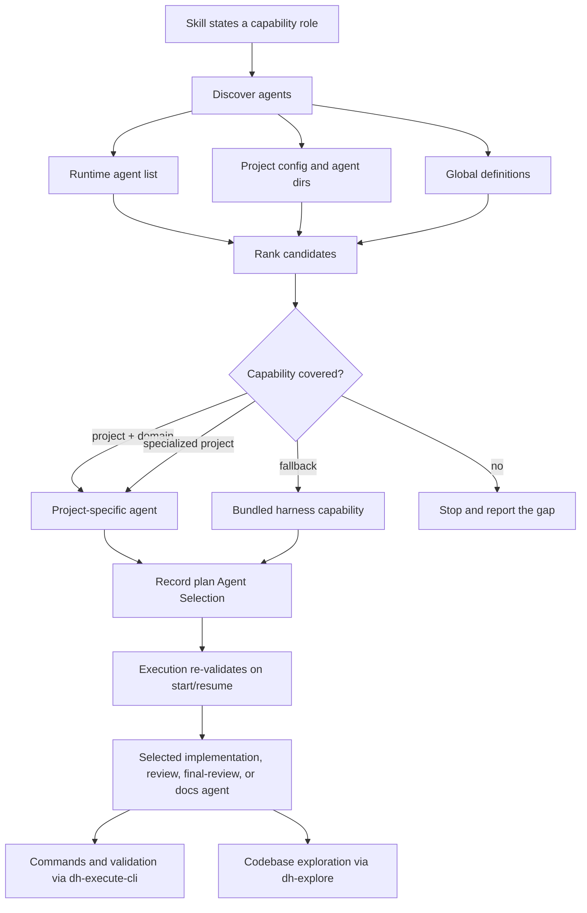

# Evolution: Agent Selection and Utility Skills

## Overview

The harness no longer hardcodes bundled `@dh-*` agents. Every delegating skill
now states a capability and resolves it through a shared selection protocol;
the chosen agent, rationale, and generic fallback are recorded in the plan's
`## Agent Selection` table and re-validated before execution. The two utility
personas became skills — `dh-executor` → `dh-execute-cli`, `dh-explorer` →
`dh-explore` — leaving an inventory of 5 agents, 24 skills (29 unique names),
and 12 unchanged MCP tools. Operationally, project-specific agents now win over
bundled fallbacks, and command execution/exploration no longer occupy
selectable agent slots.

## What Changed

- **Selection protocol.** `skills/dh-planning/references/agent-selection.md`
  (161 lines) defines discovery (runtime list → project config/agent
  directories → global definitions), seven capability roles, ranking
  (project + domain > specialized project > bundled fallback), tie handling,
  recording, re-validation on start/resume, and failure behavior.
- **Plan contract.** `## Agent Selection` (Role / Selected agent / Why /
  Fallback) sits before `## Phases`; the template, scaffold, and fixture agree,
  and the fast-plan omitted-list surfaces (`dh-execute-plan-fast`, its template
  reference, and `dh-review`) plus `FAST_OMITTED_SECTIONS` include the section.
  Plans with no delegation write `None — no specialized agent required`.
- **Delegation cleanup.** `dh-planning`, the execution/task/fast variants,
  `dh-review`, `dh-final-review`, `dh-simplify`, `dh-coding`,
  `dh-contingency`, `dh-create-documentation`, `dh-setup`, `dh-semver`,
  `dh-preflight`, `dh-artifact-check`, `dh-pause-plan`, and `dh-resume-plan`
  resolve roles through the protocol; `rg '@dh-' skills/` returns zero.
- **Utility agent → skill migration (hard cut).** `agents/dh-executor.md` →
  `skills/dh-execute-cli/SKILL.md` (123 lines), preserving least privilege and
  the `dh_logged_command` / head-tail log strategy. `agents/dh-explorer.md` →
  `skills/dh-explore/SKILL.md` (87 lines), preserving smallest-search-first,
  batching, exact file references, and no-edit/no-secret rules. No aliases for
  the removed agents.
- **Inventory.** 5 agents + 24 skills = 29 unique names; 12 MCP tools
  unchanged. Counts, regexes, and messages were updated in
  `src/cli/plugin-artifact.ts`, `scripts/lib/shared.mjs`, the pack
  contract/install/smoke scripts, `scripts/docker-test.sh`, fixtures, and
  tests; the audit reports `29 / 5/24`.
- **Guardrail.** `src/__tests__/agent-selection.test.ts` (135 lines) asserts
  over the real corpus: zero `@dh-`, removed agent files absent, both skills
  parse, protocol and plan template/scaffold/fixture agree, fast omitted lists
  include `Agent Selection`, inventory 5/24/29, and docs name both utility
  skills.
- **Docs and demos.** `AGENTS.md`, `README.md`, `docs/LOADING.md`,
  `skills/index.md`, the demo docs/config, and `opencode.example.jsonc`
  describe capability-based delegation and the utility skills; stale
  7-agent/22-skill claims are gone from the active surface.
- **Post-review fixes.** P2-1 added the selection rule to `dh-simplify`;
  P2-2 added the fast-mode recording clause to `dh-final-review`; P2-3/P3-3
  updated demo/example docs and the engineer description; P3-1 trimmed
  `dh-setup` from 251 to 249 lines; P3-2 made the scaffold emit the `None — no
  specialized agent required` default.

## Decisions and Rationale

- **Capability over names.** Agents are matched on descriptions, project
  instructions, permissions, and domain vocabulary; a familiar name is
  supporting evidence only. This avoids name-based false positives and lets
  project agents win.
- **Selection is recorded data.** The plan table (or an explicit runtime
  record) makes the run inspectable and deterministic; execution re-validates
  and stops rather than silently substituting a missing agent.
- **Utility roles are instruction layers.** Command execution and exploration
  do not need personas; converting them to skills removes two registry entries
  without changing behavior and keeps the single-executor model.
- **Hard cut, no aliases.** Aliases would preserve the old agent registry and
  undermine the inventory contract; consumers re-run
  `dev-harness install --force` and fail loudly on count mismatch.
- **Fast mirror omits selection.** Keeping `## Agent Selection` in `plan.md`
  only keeps the mirror lean; fast mode records runtime selections in
  `tasks/review.md` so `source_sha256` stays valid.

## Architecture and Modules

- Affected surfaces: `skills/` (protocol, delegation prose, two new utility
  skills), `agents/` (5 remaining definitions reworded), `src/tools/`
  (`plan-template.ts`, `plan-fast-template.ts`), `src/cli/plugin-artifact.ts`
  and `scripts/lib/*` (inventory contract),
  `src/__tests__/agent-selection.test.ts` (guardrail), and the top-level
  docs/demos.
- No changes to the MCP server/tools, CLI/package names, environment
  variables, dependency graph, or plan status model.

## Validation and Release

- `pnpm test` re-run at close-out: **46 files / 721 tests passed**, including
  the contract test and the frontmatter corpus test.
- `pnpm build`: success; `copy-assets` reports **5 agents / 24 skills** and
  syncs `dist/assets`.
- `node scripts/audit.mjs`: **PASS, 0 FAIL** (240 warn deviations; 0 size
  warnings at close-out; 468 resolved cross-references, 0 high-signature
  secrets).
- `node scripts/check-links.mjs`: **OK — no dead references** (136 references
  after this note set and index were added; 124 on the pre-note surface).
- Reference gates: `rg '@dh-' skills/` → 0; `agents/dh-executor.md` and
  `agents/dh-explorer.md` absent; inventory 5/24/29; MCP tool list 12
  unchanged.
- Smoke evidence from the final review: `smoke-load`, `smoke-mcp`,
  `smoke-install`, and `smoke-pack` passed, with `smoke-pack` run using the
  real Node path. At close-out, a repeat without that workaround reproduced
  the isolated-HOME nvm-shim failure; it passed with `NVM_DIR` exported and
  the real Node `bin` directory first on `PATH` (see observation).
- Release: **v0.5.0** (2026-11-08) — `package.json` finalized from
  `0.5.0-rc.1`; the release branch is merged to `main` and tagged `v0.5.0`.
  The changelog includes a BREAKING entry for the removed agents. npm publish
  remains a manual authenticated step.

## Follow-ups

- Merge `feature/agent-selection-skills` into `develop` with `--no-ff`; update
  the `docs/plans/index.md` row (still `Pending`) through the planning
  workflow.
- Harden `scripts/lib/pack-install.mjs` `checkMcp` so isolated-HOME smoke runs
  preserve `NVM_DIR` / the real Node `bin` path (or launch via
  `process.execPath`); today the nvm-shim host needs a manual PATH workaround.
- Align the `planBody` / `computeSourceSha256` wording with the implementation
  (leading-newline handling) or document the runtime behavior; the fast hash
  mismatch is fixed per plan, but the durable drift remains out of scope.
- Extend the contract test to docs/config `@dh-*` scanning, or keep a
  mandatory manual `rg` gate; the current test scans `skills/` and `agents/`
  only.
- Optional polish: annotate `tasks/review-fast.md` as superseded by `fast-3` /
  nine omitted sections (P3-4).
- Run the full `pnpm qa:check:full` (Docker `scan:deps` remains the accepted
  pre-existing exception) before tagging.

## Related

- Plan: [agent-selection-utility-skills](../plans/agent-selection-utility-skills/plan.md)
- SDD: [sdd.md](../plans/agent-selection-utility-skills/sdd.md)
- Final review: [tasks/review.md](../plans/agent-selection-utility-skills/tasks/review.md)
- Fast plan-end alignment: [tasks/review-fast-final.md](../plans/agent-selection-utility-skills/tasks/review-fast-final.md)
- Observation: [2026-11-08-1703-agent-selection-utility-skills](./observations/2026-11-08-1703-agent-selection-utility-skills.md)
- Protocol: [agent-selection.md](../../skills/dh-planning/references/agent-selection.md)
