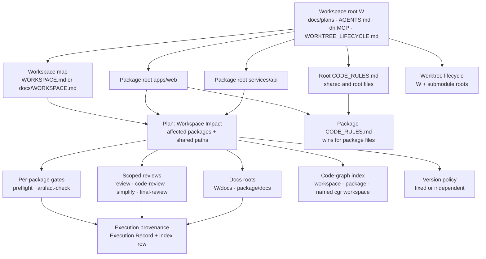

# Evolution: Harness Monorepo Awareness

## Overview

The harness now distinguishes a **workspace root** from a **package root**, a
**plan root** and a **vault root**, and every bundled surface — 26 skills, 5
agents, templates, gates, reviews, docs, code-graph routing, versioning,
worktrees and pause/resume — resolves those roots consistently. Monorepo
sessions start at the workspace root (`W`), plans live only under
`W/docs/plans`, and a package-scoped session is a hard stop rather than a second
plan tree. Standalone repositories with no workspace markers keep the previous
single-root behavior unchanged. The change is additive: the `dh` MCP schema,
plan status model, tool names and agent roster are unchanged.

The plan completed 4/4 phases and 16/16 sub-tasks on
`feature/harness-monorepo-awareness`; the final review returned **Approve with
comments** with no P0/P1 findings. It is unreleased: the recommended bump is
minor (`v0.7.0`), and no tag has been created.

## What Changed

- **Workspace contract and anchor.** [`workspace-contract.md`](../plans/harness-monorepo-awareness/workspace-contract.md)
  defines the four roots, binding rules A1–A9, a ten-row `cwd ×
  DH_WORKSPACE_ROOT` decision table, the anchor-mismatch and wrong-plan-root
  error templates, the standalone identity case, and the `dh-setup`
  verification checklist. `dh-setup` now checks `pwd -P`, the git top-level
  (plus `--show-superproject-working-tree` in submodules), the absolute
  `DH_WORKSPACE_ROOT` override, a real `dh_plan_read` path and the absence of
  package-local plan trees. The MCP resolver, tool schemas and plan parser were
  not changed.
- **Detection and workspace map.** `dh-setup` detects pnpm/npm/yarn workspaces,
  Nx/Turbo/Lerna, Cargo workspaces, Go workspaces, Gradle/.NET solutions and
  `.gitmodules`; it probes upward before declaring standalone, interviews the
  user and writes an approved `WORKSPACE.md` at `W` (fallback
  `docs/WORKSPACE.md`). The map records packages, stacks, test/build commands,
  aggregate vs affected commands, docs roots, CODE_RULES root, code-graph scope,
  worktree scope and the fixed/independent version policy. A detected workspace
  whose map was declined stops instead of silently reverting to a root-only
  gate.
- **Planning and execution provenance.** `## Workspace Impact` (affected
  packages plus `Shared paths`) is now part of the SDD template, phased-plan
  template and scaffold, and `dh-planning`/`dh-grill-sdd` capture it. Plans gain
  an `## Execution Record` after `## Final Integration & Verification`, and
  `docs/plans/index.md` gains a `## Execution Records` table before the plans
  table. The record carries the real repository/path, mirrored plan path, branch
  and commit range, summary and architectural changes; T1 writes it, T2 verifies
  it, T3 finalizes it, and T4 links the evolution note from the record when the
  executing skill closes the plan.
- **Per-package gates and scoped reviews.** `workspace-gates.md` defines affected
  vs aggregate execution with one result row per package, `pnpm`/`npm`/`yarn`/
  `Nx`/`Turbo`/`Lerna`/`Cargo`/`Go`/`Gradle`/`.NET`/submodule command patterns,
  `unknown package → FAIL`, and `none → skipped with reason`. `dh-preflight` and
  `dh-artifact-check` never report a green aggregate over an unvalidated
  package. `workspace-diff-scope.md` derives
  `affected_packages ∪ shared_paths` and all four review/simplify/final-review
  skills use `git diff -- <paths>` plus the working-tree variants; untouched
  packages are reported as unaffected.
- **Rules, docs, graph, versions and worktrees.** A package `CODE_RULES.md`
  overrides the root file for its files, root rules cover shared/root files, and
  contradictions are reported rather than silently merged. Workspace docs live
  under `W/docs`, package docs under `{package}/docs` with `package` frontmatter,
  and evolution/observation notes stay at `W`. `dh-code-query` routes to the
  workspace, package or named `cgr` workspace index and states the scope in the
  answer. `dh-semver` supports `fixed` and `independent` policies with
  confirmation before tagging. `dh-create-worktree` discovers
  `WORKTREE_LIFECYCLE.md` at the root and submodule roots and aligns submodule
  branches. `dh-pause-plan`/`dh-resume-plan` record `## Package Scope` with
  per-package fingerprints (including `gitlink:<sha>` for submodules), and
  `dh-domain-check` uses the workspace package graph before directory
  heuristics.
- **Agents and tests.** All five bundled agents carry one `## Workspace First`
  section: read the map, name affected packages, use package-scoped
  commands/diffs/docs, and fall back to the single root. Seven layout fixtures
  (pnpm, npm, Nx, Turbo, Cargo, Go, submodules) and six `workspace-*.test.ts`
  suites cover the anchor, plan contract, gates/scope/rules,
  docs/graph/version/worktree surfaces, fixtures and agent guidance.
- **User-facing docs.** `AGENTS.md`, `README.md`, `docs/LOADING.md`,
  `skills/index.md`, `CHANGELOG.md` and the audit cross-link describe the four
  roots, start-at-`W`, `DH_WORKSPACE_ROOT`, the map, per-package gates/reviews,
  docs and version policy, and execution provenance.

Implementation scope: **103 files, +6,910/−301** in
`7e2eb14^..425cc77`; 37 files under `skills/` (20 updated `SKILL.md` files out
of the 26, 16 references and `skills/index.md`), the 5 agents, the two plan
templates, the plans index, docs and tests. No package-local `docs/plans`
directory was created.

## Decisions and Rationale

- **One plan root.** `W/docs/plans` is the only plan root; a package, submodule
  or worktree never gets its own plan tree. Proved by the anchor decision table
  and by treating a pre-existing package-local plan directory as foreign:
  report it, never write to it, never delete it without confirmation.
- **Start at `W`; the override equals `W` or is unset.** `DH_WORKSPACE_ROOT`
  cannot repair a session that started inside a package, because the skill base
  is the session cwd. A mismatch is a hard stop with both roots and both plan
  dirs named, not a warning and not an auto-created directory.
- **Affected packages are declared, not derived from cwd.** `## Workspace
  Impact` is the single source for command matrices, diff scope and review
  labels; the map supplies commands, not the touched subset.
- **Additive contracts, tolerant parser.** New sections are optional for legacy
  plans and are ignored by `parsePlan`; the existing `dh` plan tools keep
  working. The plans table must stay last so `dh_plan_create`'s EOF append
  cannot land in the execution-records table.
- **Map is the command source of truth.** Unknown packages fail closed; a green
  aggregate never hides a skipped package; a skipped package needs a reason or
  an explicit deferral.
- **Package rules win locally, root rules cover shared files.** Contradictions
  are reported for a decision instead of being merged silently, so a package
  cannot accidentally relax a root security rule.
- **One vault, package mirrors.** `OBSIDIAN_VAULT` moves the vault copy only,
  never `docs/plans`; package docs keep `package` frontmatter and evolution
  notes remain workspace-root so the register stays comparable across packages.
- **Fixed versioning by default, independent by policy.** Multiple
  `package.json` files alone do not imply per-package releases; the map records
  the policy and tagging still requires explicit confirmation.
- **Root/submodule lifecycle discovery with confirmation.** A missing submodule
  lifecycle file is not an error; nested lifecycle steps run only after the user
  confirms, and the same-branch reuse rule remains.
- **No new agents.** Workspace awareness is guidance in the existing five
  agents, not a sixth persona; the capability-based delegation protocol and the
  5/26 inventory are unchanged.
- **Standalone is the identity case.** No markers and no map means
  `cwd = W = P = plan root = vault root`, one toolchain and the full diff; no
  standalone repo is required to add a map or an override.

## Architecture and Modules

- **Contract layer:** `docs/plans/harness-monorepo-awareness/workspace-contract.md`
  (normative) and the `dh-setup` workspace-map reference.
- **Planning layer:** `skills/dh-planning` (template, `execution-record.md`),
  `skills/dh-grill-sdd`, `src/tools/plan-template.ts` and
  `src/tools/plan-fast-template.ts`.
- **Gate/review layer:** `skills/dh-preflight/references/workspace-gates.md`,
  `skills/dh-review/references/workspace-diff-scope.md`, the four
  review/simplify/final-review skills and `skills/dh-artifact-check`.
- **Rules/docs/runtime layer:** `skills/dh-coding/references/code-rules-resolution.md`,
  `skills/dh-create-documentation/references/workspace-docs.md`,
  `skills/dh-code-query/references/workspace-index.md`,
  `skills/dh-semver/references/monorepo-versioning.md`,
  `skills/dh-create-worktree/references/worktree-discovery.md` and
  `skills/dh-pause-plan/references/package-scope.md`.
- **Agent layer:** `agents/dh-*.md` (`## Workspace First`) and
  `src/__tests__/workspace-agents.test.ts`.
- **Evidence layer:** seven layout fixtures and the six workspace test suites
  under `src/__tests__/`.

The design keeps the existing plan status model and MCP ownership of plan I/O;
the workspace map is a user-approved sidecar, not a second configuration
source. Nested repos/submodules/worktrees are referenced from the execution
record and map instead of receiving a plan tree.

## Validation and Release

- **Final review (T2):** [`tasks/review.md`](../plans/harness-monorepo-awareness/tasks/review.md)
  — **Approve with comments**, overall risk **Low**, no P0/P1 findings. All
  4/4 phases and 16/16 sub-tasks are `Completed`; every sub-task names an agent
  present in `## Agent Selection`.
- **Tests and static checks observed in the T2 run:** `pnpm test` → 53 files /
  937 tests; `pnpm typecheck` clean; `pnpm lint:biome` 121 files with no fixes;
  `pnpm lint:links` no dead references (243 before the review, 251 with it);
  `knip`, `jscpd` (0 clones) and `dependency-cruiser` (43 modules / 106 deps)
  clean; `pnpm run audit` exit 0 with 0 FAIL, 0 secret failures and 0 junk
  files/symlinks; `git diff --check` clean.
- **Build/artifacts:** `pnpm build` succeeded (`tsdown`, `tsc
  --emitDeclarationOnly`, `copy-assets: agents 5 | skills 26`); `dist/plugin.js`,
  `dist/mcp/stdio.js` and `dist/cli.js` exist; `dist/assets/agents` has 5 files
  and `dist/assets/skills` has 26 skill dirs plus `index.md`; `smoke-load`,
  `smoke-mcp`, `smoke-install` and `smoke-pack` passed. `smoke-pack` needs a real
  `node` ahead of the `~/.local/bin/node` shim in `PATH`.
- **Full QA gate:** `pnpm qa:check:full` was green in sub-task 4.2, including
  the Docker OSV dependency scan and Semgrep (90 rules, 0 findings). The T2 pass
  reused that evidence and did not re-run the Docker scans (network/credentials;
  no product code changed after 4.2).
- **T4 close-out:** after this note set and the `docs/evolution/index.md`
  update, `pnpm lint:links` checked **279 references** and reported **OK — no
  dead references**, and `pnpm run audit` returned **PASS, 0 FAIL, exit 0**
  (296 warn deviations, 539 resolved cross-references, 0 high-signature secret
  hits, 0 junk files, 0 symlinks). The generated `reports/audit.{json,md}` were
  restored after the run so the close-out diff stays limited to the notes and
  the index.
- **Execution record:** finalized at T3 with `Execution status: Completed`,
  `Executed at: 2026-11-11`, `Repository kind: workspace`,
  `Repository path: .`, branch `feature/harness-monorepo-awareness`, commit
  range `7e2eb14..425cc77`, `Mirrored plan path: none`, and one
  `## Execution Records` row in [`docs/plans/index.md`](../plans/index.md). No
  package-local plan directory was created.
- **Release status:** unreleased. `CHANGELOG.md` keeps the entry under
  `[Unreleased]`; `dh-semver` reasoning recommends a **minor** bump to
  **v0.7.0** because the changes add features with no `BREAKING CHANGE`. No tag
  was created by the review or by this close-out; tagging remains a
  user-confirmed step.

## Follow-ups

- **P2-2 — residual single-root guidance.** `dh-contingency`,
  `dh-mermaid`, `dh-execute-plan-task` and `dh-execute-plan-task-fast` still
  carry bare `./docs/plans` or root-only `CODE_RULES.md` wording without an
  anchor pointer. Add the one-line workspace-anchor pointer and a structural
  test that every skill writing under `docs/plans` cites the contract.
- **P2-3 — setup-generated `## Dev Harness` block.** It omits the workspace
  anchor. Add the 2–3 line monorepo block (read the map, plans at
  `W/docs/plans`, override unset/absolute `W`, stop on a package session).
- **P3-1 — `docs/WORKSPACE.md` fallback wording.** Most consuming skills name
  only root `WORKSPACE.md`; standardize on "`WORKSPACE.md`, else
  `docs/WORKSPACE.md`".
- **P3-2 — R7 coverage map.** The coverage test proves only the version-policy
  token; give R7 one distinctive needle per aspect (graph, worktree,
  pause/resume, domain).
- **P3-3 — domain dependencies.** `dh-domain-check` reads a `Dependencies`
  column the map template does not have; derive dependencies from manifests and
  the code graph, or add the column.
- **P3-4 — semver output template.** It still shows only `Tag: vX.Y.Z`; add an
  independent-policy variant (`<package>@X.Y.Z`).
- **P3-5 — Obsidian push mirror.** `obsidian-push.md` still describes a single
  `$VAULT/docs` tree; document the package mirror path or declare the push
  workspace-tree-only.
- **P3-6 — planning question bank.** Add "Affected packages (when a workspace
  map exists)" and state that the map supplies commands, not the affected set.
- **P3-7 — duplicate T3 in `dh-execute-plan`.** Keep one T3 step and reference
  it from the other.
- **P3-8 — realpath wording.** Add "after realpath normalization" to the setup
  checklist and validation item.
- **P3-9 — test strength.** Add per-row decision-table verdict assertions, use
  the `contentLines` helper, and add a fixture-driven end-to-end
  setup→gate→review scenario (or record the system-wide scenario as a manual
  check).
- **P3-10 — pre-existing empty `demo-project/docs/plans`.** Report-only; it
  pre-dates the plan and is not tracked. Do not delete without user
  confirmation.
- **Release flow.** Merge the branch per Git Flow, run `dh-semver`, create
  `v0.7.0` locally only after explicit confirmation, and do not push.
- **Environment.** Harden `scripts/lib/pack-install.mjs` `checkMcp` so an
  isolated-HOME nvm-shim host preserves `NVM_DIR`/the real Node bin path, or use
  the Docker test image for the smoke.

## Related

- Plan: [harness-monorepo-awareness](../plans/harness-monorepo-awareness/plan.md)
- SDD: [sdd.md](../plans/harness-monorepo-awareness/sdd.md)
- Contract: [workspace-contract.md](../plans/harness-monorepo-awareness/workspace-contract.md)
- Final review: [tasks/review.md](../plans/harness-monorepo-awareness/tasks/review.md)
- Phase reviews: [Phase 1](../plans/harness-monorepo-awareness/tasks/review-phase1.md),
  [Phase 2a](../plans/harness-monorepo-awareness/tasks/review-phase2a.md),
  [Phase 2a follow-up](../plans/harness-monorepo-awareness/tasks/review-phase2a-followup.md),
  [Phase 2b](../plans/harness-monorepo-awareness/tasks/review-phase2b.md),
  [Phase 3](../plans/harness-monorepo-awareness/tasks/review-phase3.md),
  [Phase 4a](../plans/harness-monorepo-awareness/tasks/review-phase4a.md)
- Audit: [2026-11-10 skills/agents standalone vs monorepo](../audits/2026-11-10-skills-agents-standalone-monorepo.md)
- Observation: [2026-11-11-0116-harness-monorepo-awareness](./observations/2026-11-11-0116-harness-monorepo-awareness.md)
- Changelog: [CHANGELOG.md](../../CHANGELOG.md)
