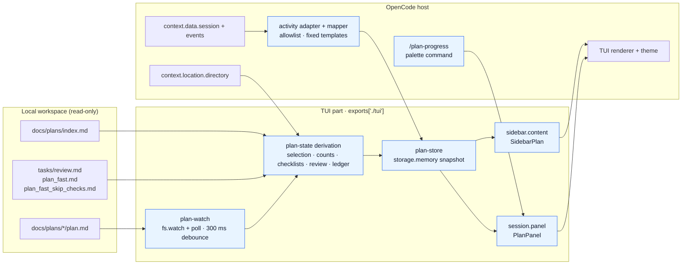

# Evolution: TUI Plan Progress

## Overview

Plan execution is now observable from inside OpenCode. The package ships a
second plugin part — `exports["./tui"]` → `dist/tui.js`, plugin id
`dev-harness-skills.tui` — that loads beside the server part and renders the
active plan's progress: an always-visible `sidebar.content` card and a
full `session.panel` opened by `/plan-progress` (palette entry "Plan
progress"). Both read the workspace `docs/plans` tree locally and are strictly
read-only: they never change plan statuses, checklists, reviews or the index.

The plan completed 4/4 phases and 14/14 sub-tasks on
`feature/tui-plan-progress`. The final review returned **Approve with
comments** (risk **Low**, no P0 and no implementation changes requested); the
two P1 findings were close-gate bookkeeping and were resolved at T3. One
verification is explicitly deferred: the live pixel check of the card, panel
and key bindings, because this environment has no TTY/interactive session. The
change is unreleased: the recommended bump is minor (`v0.8.0`), and no tag has
been created.

## What Changed

- **TUI part and loading (R1).** `package.json` exposes
  `exports["./tui"]` with `import`/`default` → `dist/tui.js` and `types` →
  `dist/tui/index.d.ts`. `src/tui/index.tsx` defines the part with
  `Plugin.define({ id: "dev-harness-skills.tui", setup })`; setup creates the
  plan store (`storage.memory`), registers one `sidebar.content` claim and one
  `session.panel` claim, adds the `/plan-progress` command layer and returns a
  cleanup that removes both claims and disposes the store. One entry loads every
  part, so a project/global `plugins` entry, a `plugins/` clone or
  `opencode plugin add` also loads the TUI part; a `cli.json` entry is only
  needed for TUI-only or remote-server setups. No server tool, MCP schema or
  plugin registration changed.
- **Sidebar card (R2).** `SidebarPlan.tsx` + `sidebar-model.ts` + `format.ts`
  render the active plan title/slug, the `Phase N · N.M` position,
  completed/total sub-tasks with a text bar (`[█░]`, ASCII fallback), the
  current sub-task's delegated agent, the plan status and a one-line activity
  (`Running edit`, `1.1 … — dh-software-engineer`,
  `2 active plans — choose one`). Width is clamped to 20–38 columns, status is
  always symbol **and** word (never color-only), and theme tokens replace
  hard-coded colors.
- **Session panel and command (R3).** `PlanPanel.tsx` + `panel-model.ts` +
  `panel-sections.ts` list every phase and sub-task with status and delegated
  agent, the `Done When`/`Acceptance Criteria` items, `plan.md` and final
  verification checkboxes, the review verdict with its source, the fast-mirror
  and skipped-check ledger state, and the last update. `panel.name` filters to
  `dev-harness-skills.plan`; `↑`/`↓` and `PgUp`/`PgDn` scroll, `f` toggles
  fullscreen, `r` refreshes, `Esc` closes, and `1`…`9` pin a plan when several
  are active.
- **Progress data layer (R4).** A pure derivation layer
  (`plan-state`, `plan-progress`, `plan-checklists`, `plan-review`,
  `plan-sidecars`, `plan-model`, `plan-render-model`) sits over a read-only
  filesystem layer (`plan-read`, `plan-read-files`, `plan-candidate`,
  `plan-select`, `plan-details`, `plan-issue`). Selection is deterministic:
  frontmatter `active`/`status`/`updated`, an index-row fallback, a manual pin
  with stale-pin fallthrough, and a multiple-plan selector with the newest
  suggested; completed/inactive plans are never auto-promoted. None, multiple,
  malformed, index-orphan and scan-error states are typed and rendered as
  empty/selector/error states.
- **Refresh (R5).** `plan-watch.ts` uses recursive `fs.watch` where available
  with a per-directory fallback and a 2 s poll, a 300 ms trailing debounce, a
  1,000 ms max wait, an `(mtimeMs, size)` fingerprint and single-flight
  refresh; `unsubscribe` closes watchers/timers and is idempotent.
  `plan-store.ts` owns the snapshot and disposes the watcher and activity feed.
- **Current activity (R6).** `activity-adapter.ts` is the only reader of raw
  TUI events and allowlists 11 types (`session.status`, `session.idle`,
  `session.retry.scheduled`, the four `session.execution.*` outcomes,
  `session.agent.selected`, `session.tool.input.started`,
  `session.tool.success`, `session.tool.failed`). `session-activity.ts`
  validates agent/tool ids and emits fixed summary templates;
  `activity-feed.ts` throttles to 100 ms (10 Hz), ignores foreign
  sessions/locations, and every subscription is disposed. Message bodies, tool
  input/output, provider errors and secrets are dropped — asserted by tests.
- **Build and package (R7).** tsdown gained a fourth single-entry build
  (`entry: { tui: "src/tui/index.tsx" }`, platform node) next to the three
  server entries. `neverBundle` keeps `@opencode/plugin/tui`, `solid-js` and
  `@opentui/*` host-provided; `yaml` is the only bundled runtime library. The
  built artifact is **291,965 B** with types at `dist/tui/index.d.ts`; its
  static imports are exactly `@opencode/plugin/tui`,
  `@opentui/solid/jsx-runtime`, `solid-js` and `node:crypto|fs|path`, with no
  relative imports, no `require` and no writer symbols. `@opentui/core`,
  `@opentui/solid` and `solid-js` are optional peer dependencies, so
  server-only installs do not grow.
- **Managed installer and packaging (R7).** `TUI_BUNDLE_FILE` is a first-class
  artifact: `requireBuiltLayout` requires a non-empty `dist/tui.js`, the staged
  copy is size-checked before the swap, the managed `package.json` publishes
  `"./tui"`, the manifest lists the artifact, and `prepare.mjs`,
  `pack-contract.mjs`, `install-smoke-checks.mjs` and `pack-install.mjs` all
  check it. Install and pack smokes gained TUI checks; the server bundle scan
  and its self-containment invariants are unchanged.
- **Host alignment.** `@opencode/plugin` moved from `2.0.20` to the host's
  `2.2.7`, with `@opencode/theme` in lockstep; a package-manifest test enforces
  both the exact pin and the installed version. The TUI surface used by this
  plan is identical across the two versions, but the refresh rebuilt and
  re-validated the server bundle and every smoke gate.
- **Docs and tests.** `README.md`, `docs/LOADING.md` (new "TUI plan progress"
  section with a command table, loading matrix, limitations and a manual
  verification note), the `AGENTS.md` pointer and the `CHANGELOG.md`
  `[Unreleased]` entry describe the feature. `src/tui` adds 27 source files
  (3,608 lines), 11 test files (2,225 lines) and 8 fixtures; the repository
  suite is 65 files / 1,085 tests, and `test/tui-bundle.test.ts` locks the
  built artifact contract. The bundled inventory stays **5 agents + 26 skills**
  (nothing under `agents/` or `skills/` changed).

Diff scale: **85 files, +11,470/−251** across `1318206...5dd085f`.

## Decisions and Rationale

- **Host singletons stay external; bundle only `yaml`.** The 1.3 spike proved
  the host evaluates `dist/tui.js` and resolves bare `@opencode/plugin/tui` and
  `@opentui/solid/jsx-runtime` through its `opentui:runtime-module:*` rewrite
  with no `node_modules` in the plugin copy (a deliberate
  `throw new Error("TUI-SPIKE-PROBE")` surfaced in the host log). Bundling
  `solid-js` would split reactivity/context and bundling `@opentui/core` would
  build renderables; both stay peers. `yaml` is bundled because the parser needs
  it and the managed copy cannot resolve bare dependencies.
- **Optional peers, not required dependencies.** `@opentui/core`,
  `@opentui/solid` and `solid-js` are `peerDependenciesMeta.optional`, so a
  server-only install keeps working and only TUI tooling needs them.
- **Read-only by construction, not by convention.** `src/tui` contains no `fs`
  write API, no `storage.store` and no session mutators; a dedicated
  dependency-cruiser rule (`tui-read-only`) enforces the boundary, and
  `resolvePlanPath` rejects `..`/separators, refuses symlinks and uses
  `O_NOFOLLOW` (covered by tests). The built artifact has zero writer symbols.
- **Local-only v1 rooted at the injected location.** `resolvePlanRoot` uses
  only `context.location.directory`: it never probes upward and never creates a
  package-local `docs/plans`, matching the workspace contract. A
  package-scoped or remote-server session shows the empty state instead of a
  guessed tree; remote plan files are deferred.
- **Compact always-visible card, opt-in detail.** The sidebar is permanent, so
  the card is width-clamped and single-purpose, while the full list lives in
  the panel behind `/plan-progress`. Status uses symbol + word for
  color-blind safety and theme tokens for light/dark hosts.
- **No new MCP tools.** The TUI reads plans directly for v1; adding a
  progress tool would couple the presentation layer to the MCP server and
  break the read-only/local-first goal.
- **Fast mode with end gates.** Execution used `plan_fast.md` and the deferred
  ledger: six standard checks per sub-task were recorded as deferred and run
  once at plan end (alignment, simplify, code review, domain check, preflight,
  artifact check). This kept 14 sub-tasks moving without per-task gate
  overhead while preserving a single end-of-plan verdict.
- **Align with the host instead of staying on older typings.** The spike showed
  the installed `2.0.20` typings drifted from the `2.2.7` host. Because the
  dependency changes the bundled server artifact, the bump was paired with the
  full build/smoke gate rather than a typecheck-only change.
- **Defer the pixel check, do not claim it.** The spike could not observe
  sidebar pixels (the card mounts only inside a session, and opening one costs
  a model turn) and `@opentui/core/testing` throws "OpenTUI native FFI is not
  available for this runtime yet" under Node. The plan records the manual session
  check as a deferral (`Completed with deferrals`) instead of asserting a
  visual pass.

## Architecture and Modules

Legend: blue = added by this plan; the host contracts and the server part are
unchanged. The plan-level diagram lives at
[diagrams/architecture.md](../plans/tui-plan-progress/diagrams/architecture.md).

- **Contract layer:** [`progress-contract.md`](../plans/tui-plan-progress/progress-contract.md)
  (data model, selection rules, checklist/review/ledger derivation, activity
  model, refresh budgets, read-only guarantee, states and consumption map) and
  [`tui-api-notes.md`](../plans/tui-plan-progress/tui-api-notes.md) (verified
  slot/panel/command/storage/session APIs and the build-spike results).
- **Data layer:** `src/tui/plan-{candidate,read,read-files,select,state,progress,details,checklists,review,sidecars,model,render-model,issue}.ts`.
- **Refresh layer:** `src/tui/plan-watch.ts`, `src/tui/plan-store.ts`.
- **Activity layer:** `src/tui/activity-adapter.ts`,
  `src/tui/session-activity.ts`, `src/tui/activity-feed.ts`.
- **View layer:** `src/tui/components/{sidebar-model,SidebarPlan,panel-model,panel-sections,PlanPanel,format,reactive}.*`.
- **Wiring:** `src/tui/index.tsx`, `src/tui/plugin-id.ts`.
- **Build/install layer:** `tsdown.config.ts` (fourth single-entry build),
  `package.json` (`exports["./tui"]`, optional peers, `files`),
  `src/cli/plugin-layout.ts` (`TUI_BUNDLE_FILE`, `requireBuiltLayout`),
  `src/cli/plugin-artifact.ts` (staged copy + managed exports) and the
  pack/install scripts.
- **Server isolation:** `src/plugin.ts` and `index.ts` changed only in
  comments; `dist/plugin.js` (200,961 B) stayed at its pre-plan size and
  `smoke-load`/`smoke-mcp` remained green.

## Validation and Release

- **Final review (T2):** [`tasks/review.md`](../plans/tui-plan-progress/tasks/review.md)
  — **Approve with comments**, overall risk **Low**, no P0, no implementation
  changes requested. Two P1 close-gate bookkeeping items (stale fast mirror and
  missing plan-end ledger outcomes) were resolved at T3.
- **Code review / simplify (end gate):**
  [`tasks/review-code.md`](../plans/tui-plan-progress/tasks/review-code.md) —
  **Approve with comments**, no P0/P1; two P2 (unrendered warnings/errors and
  unrendered ledger rows) and a P3 list are recorded as follow-ups. The review
  confirmed the artifact contains no writer code, the activity path is
  privacy-safe, slugs/symlinks are guarded, and the installer invariants hold.
- **Gates observed in the T2 run:** `pnpm test` → 65 files / **1,085 tests**;
  `tsc --noEmit` clean; Biome 161 files no findings; Knip clean; jscpd 155
  files / 0 clones; dependency-cruiser 71 modules / 167 deps no violations (new
  `tui-read-only` rule); `pnpm lint:links` 307 references no dead links; Docker
  OSV-Scanner 668 packages "No issues found"; Semgrep 90 rules / 191 targets
  0 findings; `pnpm run audit` exit 0 (5 agents + 26 skills, 0 secret/junk/
  symlink findings); `pnpm build` → `dist/plugin.js` 200,961 B,
  `dist/cli.js` 170,439 B, `dist/mcp/stdio.js` 254,173 B, `dist/tui.js`
  291,965 B, `dist/tui/index.d.ts` 723 B; `smoke-load`, `smoke-mcp`,
  `smoke-install` (4 TUI checks) and `smoke-pack` (388 files, `./tui` export +
  artifact) green. The full `pnpm qa:check:full` gate was green at T1 and every
  constituent gate was re-executed in the T2 pass.
- **Fast-mode integrity:** `plan_fast.md` was re-aligned to
  `plan_version: fast-3`, `source_sha256: c78d147b…c2ed`, and a plan-end dry-run
  now reports `aligned: true`, `differences: []`, `stale: false`; the six
  plan-end outcomes (`dh-review`, `dh-simplify`, `dh-code-review`,
  `dh-domain-check` not applicable, `dh-preflight`, `dh-artifact-check`) are in
  `plan_fast_skip_checks.md`.
- **Execution record:** finalized at T3 as `Completed with deferrals`,
  `Executed at: 2026-11-15`, workspace root
  `/home/andres/workspace/dev-harness-skills`, repository kind `workspace`,
  path `.`, branch `feature/tui-plan-progress`, commit range
  `814a8b7..5dd085f`, plan `docs/plans/tui-plan-progress/plan.md`, mirrored
  plan `docs/plans/tui-plan-progress/plan_fast.md`; one `## Execution Records`
  row was added to [`docs/plans/index.md`](../plans/index.md) and the plans row
  reads `Completed` / `Active No`.
- **Deferred verification (not claimed):** the live sidebar card, the
  `/plan-progress` panel, live refresh and the actual key bindings were **not**
  observed on screen. There is no TTY/interactive session; the card mounts only
  inside a session, opening one needs a model turn, and headless JSX rendering
  is unavailable (OpenTUI native FFI). The host **did** evaluate `dist/tui.js`
  at 2.2.7 during the 1.3 probe, the final artifact imports cleanly under Node
  with the host specifiers, and the pure view models/unit tests cover the
  rendering contract — but neither proves pixels. The plan's completion
  checklist item stays unchecked with an explicit deferral note.
- **T4 close-out gates:** `pnpm lint:links` → 344 references, **OK — no dead
  references**; `pnpm run audit` → exit 0, **PASS**, 0 FAIL, 296 warn
  deviations, 5 agents + 26 skills, 0 high-signature secret findings, 0 junk
  files, 0 symlinks, 1 pre-existing warn-only unresolved `@playwright` mention
  in `dh-setup`. Generated `reports/audit.{json,md}` were restored afterwards so
  this close-out diff stays limited to the notes and the index.
- **Release status:** unreleased (`package.json` 0.7.0). `CHANGELOG.md` keeps
  the entry under `[Unreleased]`; the semver recommendation is **minor**
  (`v0.8.0`) for one `feat:` commit with no breaking change. No tag was created
  or pushed.

## Follow-ups

- **P2-1 — render state diagnostics.** `PlanState.warnings`/`errors` and
  `selection.truncated` are derived but never shown in the ready/selector/empty
  states; the `pin-stale` footnote and the workspace-root-override warning (the
  card could read a different tree than the `dh` tools) are invisible. Add a
  compact warnings block and a sidebar hint.
- **P2-2 — render ledger rows.** `LedgerState.rowsShown` (last 20) and
  `truncated` are computed for display but only the row count is printed;
  render `check · scope · disposition` with a clipped reason and a truncation
  marker.
- **P2-3 — reconcile the contract with `plan-io`.** §2/§10.2 still say
  `src/tui` MUST NOT import `plan-io.ts`, while `plan-candidate.ts` and
  `plan-read-files.ts` import its `readPlanFile` (reviewed exception, allowed
  by the depcruise rule). Amend the contract or move the reader to a read-only
  helper. A documentation task, not a code fix.
- **P3 batch:** `src/cli/__tests__/plugin-artifact.test.ts` is 302 lines (over
  the 300-line rule); absolute filesystem paths can reach issue messages;
  alignment verdicts disappear when the ledger file is absent; quoted YAML
  dates fall back to mtime; refresh telemetry (`pending`, manual `mode`,
  250 ms warning) is incomplete; the suggested-plan sort loses the `mtimeMs`
  tie-break and re-stats candidates; `PlanPanel` rebuilds its body four times
  per update (`createMemo`); two `@opentui/core` copies and the widened
  `glob`/`minimatch` overrides need an override or a recorded rationale;
  `pnpm test` needs `dist/` (document or skip in `tui-bundle.test.ts`).
- **Docs drift:** refresh `tui-api-notes.md` §16 (still the 966 B / two-import /
  `2.0.20` spike), add `src/tui/` to the `AGENTS.md` repository layout, and
  reconcile `docs/LOADING.md`'s Docker `v2.0.18` reference with the `≥ 2.2.7`
  host requirement; the Docker image only exercises the server part.
- **Live pixel check:** run the manual session checklist at the workspace root
  with an active plan (card, `/plan-progress`, refresh after a status change,
  empty state, multiple-plan selector, `f`/`r`/`Esc`/`1…9`) and record the
  result; only then can the remaining completion item be checked.
- **Record cross-link:** the plan's `## Execution Record` → `References` does
  not yet list these notes; add the link at the next plan touch (this close-out
  is read-only on `docs/plans`).
- **Release flow:** merge per Git Flow, run `dh-semver` (recommended
  `v0.8.0`), rename `[Unreleased]` to `[0.8.0]` and create the tag locally only
  after explicit confirmation.

## Related

- Plan: [tui-plan-progress](../plans/tui-plan-progress/plan.md)
- SDD: [sdd.md](../plans/tui-plan-progress/sdd.md)
- Contract: [progress-contract.md](../plans/tui-plan-progress/progress-contract.md)
- API notes: [tui-api-notes.md](../plans/tui-plan-progress/tui-api-notes.md)
- Diagram: [architecture.md](../plans/tui-plan-progress/diagrams/architecture.md)
- Final review: [tasks/review.md](../plans/tui-plan-progress/tasks/review.md)
- Code review: [tasks/review-code.md](../plans/tui-plan-progress/tasks/review-code.md)
- Alignment review: [tasks/review-fast-final.md](../plans/tui-plan-progress/tasks/review-fast-final.md)
- Observation: [2026-11-15-2330-tui-plan-progress](./observations/2026-11-15-2330-tui-plan-progress.md)
- Changelog: [CHANGELOG.md](../../CHANGELOG.md)
- Loading guide: [docs/LOADING.md](../LOADING.md)
