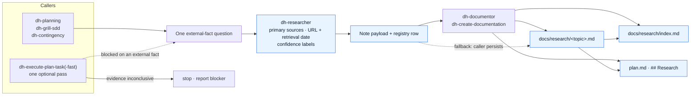

# Evolution: Web Research Agent and Skill

## Overview

The harness can now answer one question about the outside world with verifiable
evidence instead of model recollection. `dh-researcher` (sixth agent) and
`dh-research` (twenty-seventh skill) run a bounded, source-cited research pass:
one question, primary sources first, every finding carrying a source URL, a
retrieval date, and a `verified` / `partially verified` / `model knowledge`
label. Notes have one home at `docs/research/<topic>.md`, registered in
`docs/research/index.md`, and plans link them from an optional `## Research`
section. Execution may spend one such pass before reporting a blocker that
depends on current external facts, but an unresolved blocker still halts.

The change is a **fresh port of PR #4** onto the current `develop` corpus. The
PR was conflicting and written against an older 7-agent corpus; its intent was
re-implemented from 5 agents + 26 skills (31 names) to **6 agents + 27 skills
(33 unique names)**. The PR branch itself was not updated or merged.

Implementation and the verification gate are complete. Plan-end final review
and the semver decision are recorded in the plan's Execution Record once the
plan-end gates close; this note does not pre-empt either verdict.

## What Changed

- **Agent (`agents/dh-researcher.md`, 104 lines).** Folded trigger description,
  `mode: subagent`, no `permission` or `tools` keys. Workspace First resolves
  the research root from `WORKSPACE.md`/`docs/WORKSPACE.md`; six non-negotiable
  rules point at the skill as the binding workflow and enforce one question,
  primary sources, per-claim citations and retrieval dates, confidence labels,
  honest tool availability, one bounded pass, and clean queries. Output is a
  **note payload plus a proposed registry row** composed from the skill's Note
  Template; the agent is instructed not to persist, edit code, or run project
  commands.
- **Skill (`skills/dh-research/SKILL.md`, 192 lines).** `allowed-tools: read,
  webfetch, websearch` (no `write`), license/compatibility/metadata, Core Rules,
  the single-source-of-truth note/registry contract, a seven-step workflow
  (frame → plan queries → search/fetch → verify → compose → hand off → report),
  the documentation-frontmatter note template, the registry table, topic
  collision handling, safety rules, and a final checklist.
- **Registry (`docs/research/index.md`).** Obsidian frontmatter, a purpose
  statement naming the documentation owner, the canonical
  `| Date | Topic | Question | Confidence | Used by | Note |` header, and an empty
  table ("No notes registered yet") — the PR/SDD evidence stayed in the plan and
  SDD rather than being seeded as fake notes.
- **Plan format.** `## Research` sits after `## Visual Context` and before
  `## Agent Selection`, outside `## Phases`, carrying relative
  `../../research/<topic>.md` links and no status markers. It is exposed by
  `skills/dh-planning/references/phased-plan-template.md`, the
  `src/tools/plan-template.ts` scaffold, and the canonical fixture
  `src/__tests__/fixtures/plans/phased-plan.md`.
- **Fast mirror.** `Research` joined `FAST_OMITTED_SECTIONS` in
  `src/tools/plan-fast-template.ts`, and the omission is stated in
  `skills/dh-execute-plan-fast/SKILL.md`,
  `skills/dh-execute-plan-fast/references/plan-fast-template.md`, and the
  `dh-review` Plan Alignment Mode list. `plan_fast.md` omits the section on
  purpose; the source plan remains the link surface.
- **Execution unblock.** `skills/dh-execute-plan-task/SKILL.md` and
  `skills/dh-execute-plan-task-fast/SKILL.md` each gained exactly **one** line:
  when the blocker depends on current external facts and browsing tools exist,
  run `dh-research` for one cited pass and register the note under
  `docs/research/`; inconclusive evidence still stops for guidance. Both
  hard-blocker sentences are intact, and no skill claims a research gate or a
  loop step.
- **Planning integration.** `dh-planning` gained a research rule and a workflow
  step (renumbering the steps after it), `dh-grill-sdd` treats external-fact
  gaps as research questions cited by note path, and `dh-contingency` surveys
  current versions/EOL/API status and adds the Safety rule that alternatives
  are "rated only on verified facts" with missing evidence labelled as an
  assumption. `dh-create-documentation/references/workspace-docs.md` gained the
  research-note and research-index rows and the no-plan-copies rule.
- **Inventory sweep.** Counts moved to 6 / 27 / 33 in `assets.test.ts`,
  `frontmatter.test.ts`, `registration.test.ts`, `agent-selection.test.ts`,
  `workspace-agents.test.ts` (plus a `dh-researcher` workspace-first case), the
  TUI checklist fixture/test, `CLI EXPECTED_*`, the install-harness fixture,
  install-command assertions, the `LOOP` lists in `scripts/lib/shared.mjs`, the
  pack scripts and their comments, `src/plugin.ts`, and the audit loop
  membership. The sweep also fixed a latent pack-smoke message that compared
  `skillCount !== 25` while the assertion expected 26.
- **Tests.** New `src/__tests__/research-contract.test.ts` (184 lines) pins the
  assets, the note/registry contract, the documentation handoff, the absence of
  plan-local paths and `step 2.4`, the plan-section order and fast omission on
  every documented surface, one `dh-research` line plus the halt sentence per
  execution skill, and the planning/contingency integration. Corpus counts stay
  in the existing inventory tests.
- **Project docs.** `README.md`, `AGENTS.md` (role summary, runtime contract,
  `W/docs/research` ownership, capability list, provenance, registration,
  layout), `skills/index.md` (27 skills, research row, 6-agent list),
  `docs/LOADING.md`, `opencode.example.jsonc`, `demo-project/docs/index.md`, and
  `CHANGELOG.md` (`## [Unreleased]` Added/Changed) describe the capability and
  the ownership boundary. `reports/audit.{md,json}` were regenerated.

Diff scale at the 3.2 gate: **40 tracked files, +460/−249**, plus four new
content files that were still untracked (`agents/dh-researcher.md`,
`skills/dh-research/SKILL.md`, `docs/research/index.md`,
`src/__tests__/research-contract.test.ts`).

## Decisions and Rationale

- **Fresh port instead of rebasing PR #4.** The PR conflicts with `develop` and
  targets agents that no longer exist: `@dh-explorer` and `@dh-executor` became
  the `dh-explore` and `dh-execute-cli` skills. Re-implementing the intent kept
  the diff small and reviewable; the PR stays as design input and is not
  updated.
- **One registry, no plan copies (review comment 1).** Notes live only at
  `docs/research/<topic>.md` with `docs/research/index.md` as the only index;
  a plan-local `research/` folder is rejected and redirected. Plans link the
  shared folder through `## Research` instead of owning evidence. This keeps one
  discoverable evidence base and prevents the same question being answered in
  two places.
- **Documentation ownership stays intact (review comment 1, ownership half).**
  The researcher composes; `dh-documentor` persists through
  `dh-create-documentation`. The skill declares only `read, webfetch,
  websearch` and the agent is instructed not to persist; the fallback returns
  the payload to the caller when nested delegation is unavailable. Research
  notes therefore follow the same generated-document contract as every other
  doc.
- **Optional execution unblock, not a loop step (review comment 2).** Research
  is one line in each execution task skill, gated on browsing availability and
  bounded to one pass. It is not a gate, not mandatory, and never clears an
  unresolved blocker. The "loop step 2.4" framing was dropped from both assets
  and is now forbidden by the contract test.
- **Optional `## Research` outside the phases region.** The parser ignores
  top-level sections outside `## Phases`, so legacy plans parse unchanged and
  the fast mirror can omit the section without breaking structural parity.
  Links use `../../research/<topic>.md` so they resolve from `plan.md`.
- **No new dependency, provider, or MCP.** The capability uses the host's
  `webfetch`/`websearch` or an already configured search MCP. With no browsing
  tool it fails loudly instead of inventing a cited answer; no search server was
  installed or bundled.
- **Confidence over false certainty.** Three labels, retrieval dates, version
  pins, and explicit conflict reporting make weak evidence visible; a claim with
  no source is labelled `model knowledge` or dropped. This is what lets planning
  and contingency distinguish a fact from a prior.
- **Empty registry is honest.** The registry ships with no rows because no
  research note exists yet; PR #4 review evidence belongs in the plan/SDD, not
  in fabricated note rows.
- **Pack/inventory sweep includes comments and fixtures.** Counts are asserted
  in tests, CLI constants, smoke checks, and prose; changing only the tests
  would leave stale expectations in the package gate and in docs.

## Architecture and Modules

Legend: blue = added by this change. The plugin registration surface is still
agents + skills only; there is no tool, command, or prompt domain for research.
The plan-level component diagram lives at
[diagrams/components.md](../plans/dh-research-agent-skill/diagrams/components.md).

- **Agent:** `agents/dh-researcher.md`.
- **Skill:** `skills/dh-research/SKILL.md` (workflow, templates, registry rules).
- **Registry:** `docs/research/index.md`; notes at `docs/research/<topic>.md`.
- **Plan surface:** `## Research` in the planning template, the scaffold, the
  canonical fixture, and the fast-mirror omission lists.
- **Execution surface:** one line in `dh-execute-plan-task` and
  `dh-execute-plan-task-fast`; the halt policy is unchanged.
- **Ownership:** `dh-create-documentation` + `dh-documentor` persist notes,
  registry rows, and plan links.
- **Tests:** `src/__tests__/research-contract.test.ts` plus the corpus inventory
  surfaces (assets, frontmatter, registration, agent selection, workspace
  agents, CLI, pack smokes).

## Validation and Release

- **Gate observed at Sub-Task 3.2 (2026-11-16):** `pnpm build` → 6 agents |
  27 skills; `pnpm test` → **66 files / 1,113 tests**; `pnpm typecheck` clean;
  `pnpm run audit` → **PASS**, 33 items, 27/27 skills, 6/6 agents, 0 FAIL,
  302 warn deviations; `pnpm lint:biome` and `pnpm format:biome:check` clean;
  `pnpm lint:knip` clean; `pnpm lint:dup` 0 clones; `pnpm lint:depcruise`
  clean; `pnpm lint:links` → 380 references, no dead links.
- **Packaging smokes:** `scripts/smoke-load.mjs` green; `scripts/smoke-mcp.mjs`
  → 12 tools; `scripts/smoke-install.mjs` green; `scripts/smoke-pack.mjs` →
  392 files with the 6-agent/27-skill inventory.
- **Security scans:** Docker OSV-Scanner (`scan:deps`) and Semgrep
  (`scan:code`) both reported 0 findings.
- **Regenerated artifacts:** `reports/audit.md` / `reports/audit.json` now
  report 33 inventory items and 34 frontmatter files, with the only new deviation
  being the same warn-only "agent missing `model`" note the other five agents
  already carry.
- **Fast-mode integrity:** the pre-execution alignment review
  ([tasks/review-fast.md](../plans/dh-research-agent-skill/tasks/review-fast.md))
  approved the mirror and treated the `## Research` omission as intentional;
  Sub-Task 1.3 then added it to every allowed-omission surface.
- **Release status:** package `0.8.0`; the change sits under `## [Unreleased]`
  and no tag was created. Final review and the version recommendation are
  plan-end outcomes, recorded in the plan's Execution Record when those gates
  close — not claimed here.
- **Execution record:** this close-out does not edit `docs/plans/`; the
  orchestrator finalizes the record, its references, and the plans index row.

## Follow-ups

- **`dh-setup` search-MCP audit (deferred).** Decide whether setup should detect
  and report a search-capable MCP; today research fails loudly when no browsing
  tool exists, which is honest but late. Owner: a future setup/planning change.
- **Research in review skills (deferred).** `dh-review` and `dh-code-review`
  could use one research pass for CVE applicability, API status, or version
  claims; out of scope here to keep the review contracts unchanged.
- **Note retention (deferred).** The registry keeps every note; revisit a
  retention or archival policy when volume makes the newest-first table hard to
  scan. No deletion is automated today.
- **PR #4 disposition.** The branch was intentionally left untouched. Decide
  whether to close it as superseded and point it at this plan, or keep it as a
  historical design reference.
- **First real note.** The registry is empty by design. The first production
  research pass should validate the template and row shape against a live
  question and, if it exposes friction, amend the skill template rather than
  hand-editing notes into a new shape.
- **Semver.** Run `dh-semver` at release time; the change adds one agent, one
  skill, a registry, a plan section, and an execution unblock with no breaking
  change, but the recommendation is not decided in this note.

## Related

- Plan: [dh-research-agent-skill](../plans/dh-research-agent-skill/plan.md)
- SDD: [sdd.md](../plans/dh-research-agent-skill/sdd.md)
- Fast alignment review: [tasks/review-fast.md](../plans/dh-research-agent-skill/tasks/review-fast.md)
- Domain check: [tasks/domain-check.md](../plans/dh-research-agent-skill/tasks/domain-check.md)
- Components diagram: [diagrams/components.md](../plans/dh-research-agent-skill/diagrams/components.md)
- Agent: [dh-researcher.md](../../agents/dh-researcher.md)
- Skill: [skills/dh-research/SKILL.md](../../skills/dh-research/SKILL.md)
- Registry: [docs/research/index.md](../research/index.md)
- Observation: [2026-11-16-0110-dh-research-agent-skill](./observations/2026-11-16-0110-dh-research-agent-skill.md)
- Changelog: [CHANGELOG.md](../../CHANGELOG.md)
- Runtime contract: [AGENTS.md](../../AGENTS.md)
