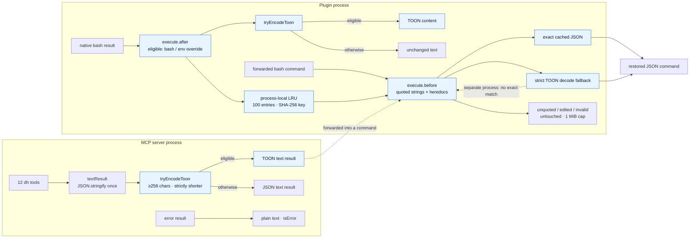

# Evolution: TOON Output Integration

## Overview

The harness now spends fewer tokens on the payloads it already produces. Two
output surfaces can emit TOON — a compact, lossless encoding of the JSON data
model — instead of JSON: the 12 `dh` MCP tools and eligible native tool output
processed by the V2 plugin. Both use one shared, conservative codec: the payload
must serialize to at least 256 characters of JSON and its TOON form must be
strictly shorter, otherwise the text stays JSON. JSON remains canonical
internally and on disk; every TOON payload decodes to the same value the JSON
carried.

The change is deliberately a translation layer, not a schema change. Tool
names, inputs, error messages, the 12-tool MCP surface, 6 agents, and 27 skills
are unchanged. The plugin still registers no tools, commands, or prompts; it now
registers exactly two native `execute` hooks (`execute.after` compression,
`execute.before` restoration). Because the MCP server and the plugin are
separate processes, restoration is exact only for native output compressed in
the same process; MCP TOON forwarded into a shell command takes the
valid-TOON-decode fallback.

The implementation and the full verification gate are complete. The version
decision is pending the plan-end semver step: the package is at `0.9.0` and a
minor bump to `0.10.0` is the likely outcome. No tag was created on the feature
branch.

## What Changed

- **Shared codec (`src/lib/toon.ts`, 96 lines).** `tryEncodeToon` accepts only
  non-null objects and arrays, requires `JSON.stringify` output of at least
  `TOON_MIN_CHARS` (256), and returns TOON only when it is strictly shorter.
  Encoder failures (circular structures, `BigInt`, a `toJSON` that yields
  `undefined`) return `undefined` instead of throwing; every call site therefore
  reads `toon ?? json`. `decodeToon` is strict and returns `undefined` on empty,
  edited, or malformed input. `looksLikeJson` and `looksLikeToon` are cheap
  sniffs; the latter requires multi-line text of at least 64 characters with a
  tabular TOON header. The encoder uses a tab delimiter so the encoder and the
  sniffer agree on the array header shape. No I/O, logging, or payload
  retention lives in the codec.
- **Automatic MCP output (`src/mcp/tool-results.ts`).** `textResult` computes
  the JSON once and returns `tryEncodeToon(payload, json) ?? json`. All 12 tools
  flow through this single conversion point; no tool schema, input, or success
  shape changed. Error results remain plain text with `isError` and are never
  encoded. Clients and test helpers must parse both formats.
- **Native compression (`src/tools/toon-hooks.ts`, 300 lines).** The
  `execute.after` hook rewrites an eligible tool result when its text is valid
  JSON of at least 256 characters and TOON is strictly shorter. Eligibility
  defaults to `bash` and is overridden by `OPENCODE_TOON_PLUGIN_TOOLS`
  (comma-separated, trimmed, lowercased, empty entries dropped; an empty value
  falls back to `bash`). A string `content` is replaced; for a content block
  array the first eligible text block is replaced and every other block —
  including file blocks — stays untouched; a string `output` is a fallback
  channel used only when `content` yielded no conversion. The helper never
  throws into the host.
- **Restore cache.** Converted payloads are remembered in a process-local,
  100-entry cache keyed by the SHA-256 of the trimmed TOON text. A hit deletes
  and re-inserts the entry, so recency is refreshed and eviction is true LRU
  rather than FIFO; the bound is enforced after every insert. The cache is never
  persisted and is cleared by a test hook.
- **Forwarded restoration (`execute.before`).** The hook scans a forwarded bash
  command and rewrites only single-quoted strings, double-quoted strings, and
  heredoc bodies. For each candidate it tries the exact cache first, then a
  strict TOON decode of a clean TOON document; the restored value is serialized
  back to JSON and inserted as a single-quoted shell string with `'` escaped as
  `'\''`. Unquoted words, comments, unterminated quotes or heredocs, and
  ANSI-C `$'...'` strings are copied verbatim. Inserted JSON is never rescanned,
  so restoration cannot recurse, and commands over 1 MiB are returned unchanged.
- **Plugin registration (`src/plugin.ts`).** Exactly two native tool execute
  hooks were added beside the 6 agents and 27 skills. Cleanup disposes both
  hooks. There are zero tool, command, or prompt registrations and zero
  tool/command/prompt transforms.
- **Dependency and build (`package.json`, `tsdown.config.ts`).**
  `@toon-format/toon` is pinned at `4.4.0` and bundled into `dist/plugin.js` and
  `dist/mcp/stdio.js`; managed installs and `npx` never resolve a bare import at
  load time. `dist/assets` is unchanged.
- **Tests (four new suites).** `toon-codec.test.ts` covers the threshold,
  validity, strict shorter check, round-trip equality, and failure tolerance;
  `mcp-toon.test.ts` covers automatic output, JSON fallback, error passthrough,
  and decode equality; `toon-hooks.test.ts` covers content string, block array,
  `output` fallback, eligibility and env override, inert malformed shapes, and
  the cache bound; `toon-restore.test.ts` covers quoted and heredoc exact
  matches, unknown-TOON fallback, edited/invalid/unquoted untouched, ANSI-C
  exclusion, escaping, and the size cap. The MCP test helper and the server
  tests now decode JSON or TOON instead of assuming JSON.
- **Project docs.** `README.md`, `AGENTS.md`, `docs/LOADING.md` (a new
  `## TOON output` section with the decision flow, hook behavior, env override,
  cache limits, and process boundary), `opencode.example.jsonc`,
  `skills/dh-execute-cli/SKILL.md`, and `CHANGELOG.md` (`## [Unreleased]`
  Added/Changed) describe the contract. `reports/audit.{md,json}` were
  regenerated.

At the 3.2 gate the work was still uncommitted on
`feature/toon-output-integration`: 20 modified tracked files plus the new
implementation, test, plan-sidecar, and close-out files. No commit range is
claimed in this note.

## Decisions and Rationale

- **JSON stays canonical; TOON is model-facing only.** Every encoded payload
  must decode to the original value, and plan/sheet/database files remain JSON
  or their native format. This keeps the change reversible at the boundary and
  removes any migration or compatibility risk.
- **One helper, two surfaces.** MCP and the plugin share `tryEncodeToon` and the
  same 256-character/strictly-shorter rule. A second implementation would drift
  on the edge cases that make automatic encoding safe.
- **Automatic, not opt-in.** The request was automatic TOON where it pays off.
  An MCP `format` parameter would have changed all 12 tool schemas and forced
  every caller to choose; a single `textResult` conversion avoids schema churn
  and adapts helpers instead.
- **Conservative eligibility.** Non-object payloads, short JSON, invalid JSON,
  non-shorter encodings, and encoder errors all keep JSON. The threshold avoids
  spending tokens on a header that smaller payloads do not amortize, and the
  strict shorter check makes the change a net win by construction.
- **`bash` only by default; env override for the rest.** The reference behavior
  and the requested default are `bash`. `OPENCODE_TOON_PLUGIN_TOOLS` covers other
  native tools without widening the default or requiring a config schema.
- **Two restoration paths, exact first.** In-process exact match preserves the
  original byte representation, including key order and whitespace. The strict
  decode fallback covers TOON produced elsewhere — notably MCP TOON forwarded
  into bash — because the MCP server is a separate process. The fallback is
  semantic, not byte-exact, and the docs say so.
- **Shell safety over coverage.** Only quoted strings and heredoc bodies are
  candidates; unquoted text, comments, ANSI-C quoting, and incomplete constructs
  are left byte-identical. A wrong rewrite inside a command is worse than a
  missed optimization.
- **True LRU, bounded at 100.** An unbounded map leaks memory across a long
  session; no cache loses exact restoration for the common "read output, then
  forward it" flow. Refreshing recency on hit makes the bound evict the least
  recently used payload, not merely the oldest insertion.
- **Bundle the codec.** A managed plugin install and `npx` cannot rely on a
  transitive `node_modules` resolution. Pinning `4.4.0` and bundling into both
  artifacts makes the package self-contained; a package-size regression is
  accepted for that guarantee.
- **No new MCP tool or command.** The feature is a serialization change, not a
  capability. Keeping the 12-tool surface and the registration contract intact
  keeps existing clients and permissions valid.
- **Tests decode instead of weakening assertions.** JSON-only helpers would fail
  on large MCP payloads after the change. Parsing JSON then TOON preserves the
  same semantic assertions rather than lowering coverage or opting tests out.

## Architecture and Modules

Legend: blue = added by this change. The MCP server and the plugin are separate
processes; only native output compressed in the plugin process can hit the exact
cache. Plan-level diagrams: [components](../plans/toon-output-integration/diagrams/components.md),
[current state](../plans/toon-output-integration/diagrams/current-state.md),
[desired state](../plans/toon-output-integration/diagrams/desired-state.md), and
[critical changes](../plans/toon-output-integration/diagrams/critical-changes.md).

- **Codec:** `src/lib/toon.ts` — threshold, strict shorter check, encode/decode,
  sniffs, cache bound constant.
- **MCP surface:** `src/mcp/tool-results.ts` (`textResult`),
  `src/mcp/server.ts`, `src/mcp/stdio.ts`.
- **Native hooks:** `src/tools/toon-hooks.ts` — eligibility, compression, cache,
  quoted/heredoc restoration, size cap.
- **Registration:** `src/plugin.ts` — two execute hooks, no tools/commands/prompts.
- **Build:** `tsdown.config.ts` — bundles `@toon-format/toon` into the plugin and
  MCP artifacts.
- **Tests:** `src/__tests__/toon-codec.test.ts`,
  `toon-hooks.test.ts`, `toon-restore.test.ts`, `mcp-toon.test.ts`, plus the
  adapted MCP helper (`src/__tests__/helpers/mcp.ts`) and MCP server tests.
- **Docs:** `README.md`, `AGENTS.md`, `docs/LOADING.md`,
  `skills/dh-execute-cli/SKILL.md`, `CHANGELOG.md`,
  `opencode.example.jsonc`.

## Validation and Release

Observed at the Sub-Task 3.2 gate on 2026-11-16:

- **Build:** `pnpm build` emitted plugin, MCP, CLI, and TUI bundles;
  `dist/plugin.js` and `dist/mcp/stdio.js` contain the TOON logic with no bare
  `@toon-format/toon` import; `dist/assets` still holds 6 agents and 27 skills.
- **Tests:** 70 files / 1,169 tests passed. Typecheck clean.
- **Lint:** Biome lint and format clean; Knip clean; jscpd 0 clones;
  dependency-cruiser clean.
- **Links:** 432 references, no dead links.
- **Audit:** PASS — 6 agents, 27 skills, 0 FAIL, 0 high-signature secrets, 0 junk.
- **Smokes:** `smoke-load` green; `smoke-mcp` reports 12 tools and round-trips
  plan and fast plans; `smoke-install` green; `smoke-pack` 392 files with the
  6/27 inventory and offline import.
- **Security scans (Docker):** OSV-Scanner `scan:deps` 0 issues across 669
  packages; Semgrep `scan:code` 0 findings across 90 rules and 198 files.
- **Preflight:** READY, 0 failures; the only warning is the expected dirty
  working tree before close-out commits.
- **Artifact check:** READY, 0 failures; no production deploy scripts are in
  scope.
- **Release status:** package `0.9.0`; the change sits under
  `## [Unreleased]` in `CHANGELOG.md`. The likely release decision is a minor
  bump to `0.10.0` (one feature, no breaking change), pending the plan-end
  final review and `dh-semver`. No tag or push was performed.

## Limitations

- **Conditional by design.** TOON is never guaranteed. Payloads below 256
  characters of JSON, non-object payloads, non-JSON text, and payloads whose
  TOON form is not strictly shorter stay JSON.
- **Semantic, not byte-exact, cross-process restoration.** Exact-match
  restoration requires the same process that compressed the payload. MCP TOON
  forwarded into bash is decoded and re-serialized, so key order or whitespace
  may differ from the MCP server's original JSON even though the value is equal.
- **Process-local cache.** The 100-entry cache dies with the process; nothing is
  shared between the plugin, the MCP server, or concurrent sessions.
- **JSON data model only.** Prose, logs, and arbitrary text are never encoded,
  and TOON is not used for on-disk plans, sheets, or configuration.
- **Shell scope.** Restoration deliberately ignores unquoted payloads, comments,
  ANSI-C quoting, and malformed constructs, and skips commands over 1 MiB. A
  forwarded payload outside those shapes stays TOON.
- **No benchmark yet.** The gate proves correctness, compatibility, and
  packaging, not a measured token or latency win on real workloads.

## Follow-ups

- **Benchmark real workloads.** Measure tokens and latency for plan reads, sheet
  queries, and large `bash` JSON on representative sessions; if the 256-character
  threshold or the tabular shape underperforms, tune with data rather than
  intuition.
- **Optional disable switch.** Consider `DH_TOON=off` or an MCP configuration
  surface if a client cannot parse TOON or an operator wants JSON-only output.
  Today the only control is `OPENCODE_TOON_PLUGIN_TOOLS` for native tools.
- **Shared or cross-process cache (only if needed).** A same-machine cache would
  make MCP-to-bash restoration byte-exact, but it adds storage, invalidation, and
  coupling. Keep the decode fallback unless real usage shows a semantic
  difference that matters.
- **Other host tools.** Evaluate TOON for `shell`, read/search, or other native
  tools through `OPENCODE_TOON_PLUGIN_TOOLS`; the default stays `bash` until
  evidence supports widening it.
- **Client guidance.** Keep the README/LOADING "parse JSON, then strict TOON"
  instruction prominent; a JSON-only client will surface a parse error on large
  payloads even though the server behavior is correct.
- **Release.** Run `dh-semver` and finalize `CHANGELOG.md` at plan end; the
  expected bump is minor (`0.10.0`), and tagging happens on `main` per Git Flow.

## Related

- Plan: [toon-output-integration](../plans/toon-output-integration/plan.md)
- SDD: [sdd.md](../plans/toon-output-integration/sdd.md)
- Observation: [2026-11-16-0248-toon-output-integration](./observations/2026-11-16-0248-toon-output-integration.md)
- Components diagram: [diagrams/components.md](../plans/toon-output-integration/diagrams/components.md)
- Codec: [src/lib/toon.ts](../../src/lib/toon.ts)
- Hooks: [src/tools/toon-hooks.ts](../../src/tools/toon-hooks.ts)
- MCP result helper: [src/mcp/tool-results.ts](../../src/mcp/tool-results.ts)
- Tests: [toon-codec.test.ts](../../src/__tests__/toon-codec.test.ts)
- Changelog: [CHANGELOG.md](../../CHANGELOG.md)
- TOON specification: [toon-format/toon](https://github.com/toon-format/toon)
- Reference plugin: [fbosch/opencode-toon-plugin](https://github.com/fbosch/opencode-toon-plugin)
