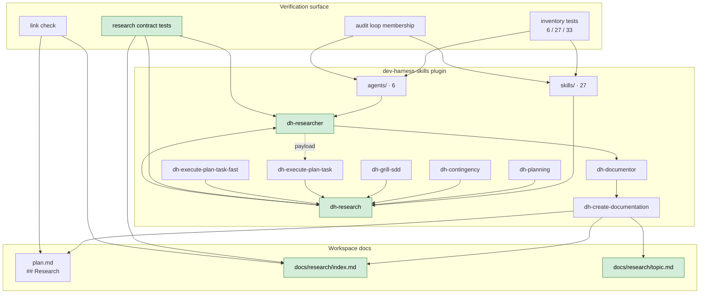

# Web Research Agent and Skill — Components

## Overview

The research capability sits beside the existing planning and execution loop.
It adds one agent, one skill, and one workspace registry; the plugin continues
to register assets only, while documentation writes stay with the documentation
agent.

## Notes

- The plugin’s registration surface stays agents + skills only; research adds no
  tool, command, or prompt domain.
- `dh-documentor`/`dh-create-documentation` own persistence; the researcher
  returns a payload.
- Tests enforce the inventory, the registry contract, the plan section, and the
  optional execution line.

## Related

- [Plan](../plan.md) · [Diagram index](./index.md)
