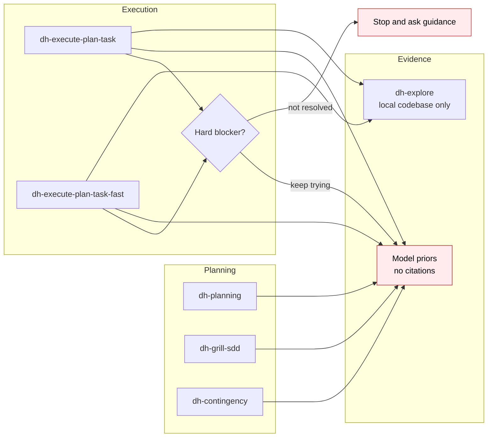

# Web Research Agent and Skill — Current State

## Overview

Planning and execution answer external-fact questions from model knowledge plus
the local codebase. There is no web-research capability, no research registry,
and a blocker either gets guessed at or halts the loop before any external
evidence is gathered.

## Notes

- `dh-explore` only reads the local repository; it cannot verify versions, EOL
  status, upstream issues, or current API behavior.
- The hard-blocker halt is correct, but it fires without a bounded external
  evidence attempt.
- There is no `docs/research/` folder or registry in the workspace.

## Related

- [Plan](../plan.md) · [Diagram index](./index.md)
