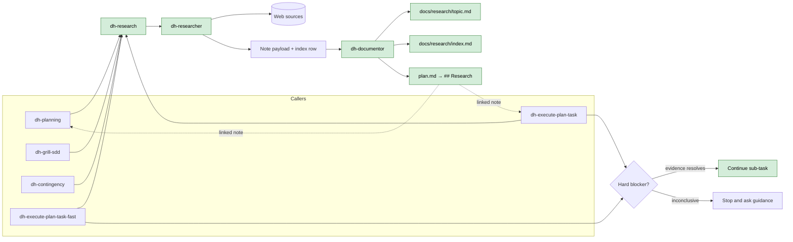

# Web Research Agent and Skill — Desired State

## Overview

Planning, contingency, SDD, and execution can delegate one bounded question to
`dh-researcher`, which returns cited findings. The documentation agent persists
the note and index in `docs/research/`, plans link the note, and execution gets
one optional unblock attempt before the hard-blocker halt.

## Notes

- `dh-researcher` does not write; it composes the note payload and the proposed
  index row.
- `dh-documentor` writes the note, updates `docs/research/index.md`, and adds or
  updates the plan’s `## Research` links.
- The optional unblock is one pass; an unresolved blocker still halts.
- The fast mirror omits `## Research` because it sits outside the phases region.

## Related

- [Plan](../plan.md) · [Diagram index](./index.md)
