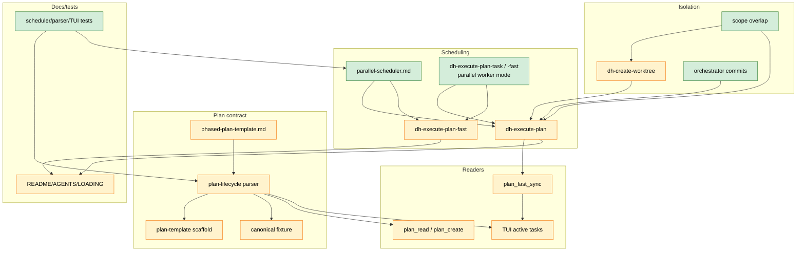

# Parallel Plan Execution — Components

## Overview

The change adds parallel metadata to the plan contract, a shared scheduler
reference, worker mode in the task skills, and hybrid isolation. Plan tools and
the TUI expose/tolerate multiple active tasks.

## Notes

- `parallel-scheduler.md` is the single detailed contract; both orchestrators
  link it.
- `plan_read` exposes the metadata; `plan_create`/scaffold render it; the TUI
  shows multiple active tasks.
- `dh-create-worktree` supplies the per-task branch/worktree lifecycle; the
  orchestrator owns integration/merge order.
- Tests cover parser defaults, scheduler readiness, scope/worktree policy,
  worker envelopes, resume, and fast mirroring.

## Related

- [Plan](../plan.md) · [Diagram index](./index.md)
