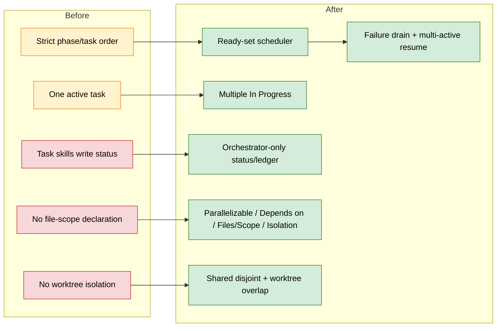

# Parallel Plan Execution — Critical Changes

## Overview

The risky shifts are schema metadata, status ownership, isolation, and resume.
Everything else builds on the existing phased model and review gates.

**Legend:** green = new, amber = changed, red = removed.

## Notes

- The scheduler cannot infer independence; explicit plan metadata is the
  contract.
- Same-worktree concurrency requires disjoint declared scope; unknown scope
  serializes.
- Workers never commit in a shared worktree; the orchestrator serializes git
  operations.
- Fast mode uses the same scheduler with serialized ledger writes and end gates.

## Related

- [Plan](../plan.md) · [Diagram index](./index.md)
