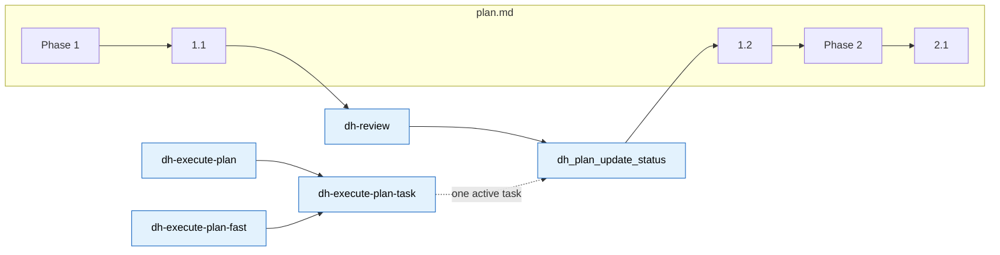

# Parallel Plan Execution — Current State

## Overview

Execution is strictly sequential: `dh-execute-plan` walks phases in order, one
sub-task at a time; `dh-execute-plan-task` selects exactly one active sub-task;
the fast orchestrator has the same single-task model. Plans cannot declare
dependencies or parallel-safe scopes.

## Notes

- One active sub-task at a time; multiple `In Progress` is treated as ambiguous.
- No `Parallelizable`, `Depends on`, `Files/Scope`, or `Isolation` metadata.
- No worktree isolation for concurrent work because there is no concurrency.
- TUI derives a single current sub-task.

## Related

- [Plan](../plan.md) · [Diagram index](./index.md)
