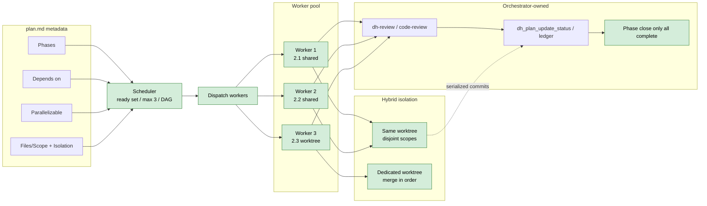

# Parallel Plan Execution — Desired State

## Overview

Both orchestrators run a shared DAG scheduler over explicitly declared phases
and sub-tasks. Up to three workers run concurrently; disjoint work shares a
worktree, overlapping/resource-heavy work uses a worktree; the orchestrator is
the only status/ledger writer.

## Notes

- Default concurrency is 3; hard cap 8.
- Legacy plans without metadata stay sequential.
- Workers return a result envelope and never edit plan files or commit in a
  shared worktree.
- Multiple `In Progress` phases/sub-tasks are expected; phase closure is still
  all-sub-tasks-complete.
- Worktree tasks integrate in dependency/plan order; conflicts block.

## Related

- [Plan](../plan.md) · [Diagram index](./index.md)
