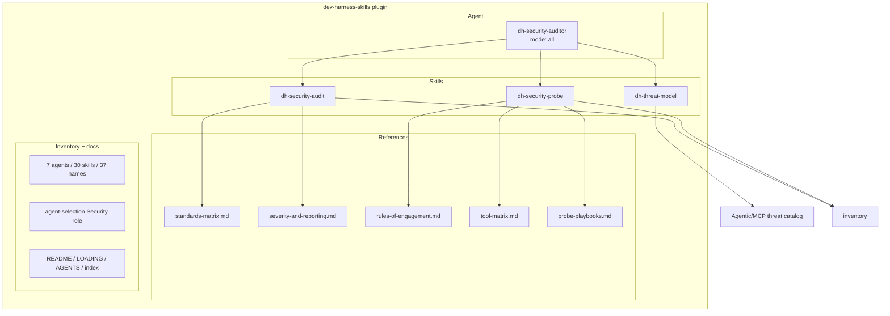

# Enterprise Security Auditor — Components

## Component graph

## Interface boundaries

- The agent owns the engagement narrative; skills own repeatable procedures.
- The audit skill consumes the threat model and probe results; it does not run
  active tests itself.
- The probe skill is the only path to active targets and is authorization-gated.
- Reports are written through the documentation owner for long-lived artifacts;
  plan-scoped evidence stays under `docs/plans/<slug>/tasks/`.
