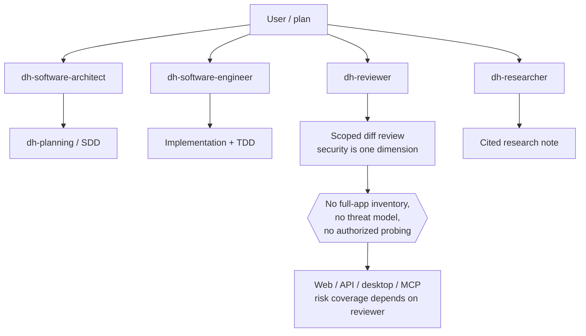

# Enterprise Security Auditor — Current State

## Overview

The harness has architecture, implementation, review, research and domain
checks. Security is a review dimension inside `dh-code-review`, not a dedicated
capability with standards coverage, threat modeling or authorized probing.

## Key observations

- Security findings are diff-scoped and ad hoc; there is no control matrix.
- Agentic/MCP threats are not modeled.
- There is no safe, authorization-gated probe workflow.
