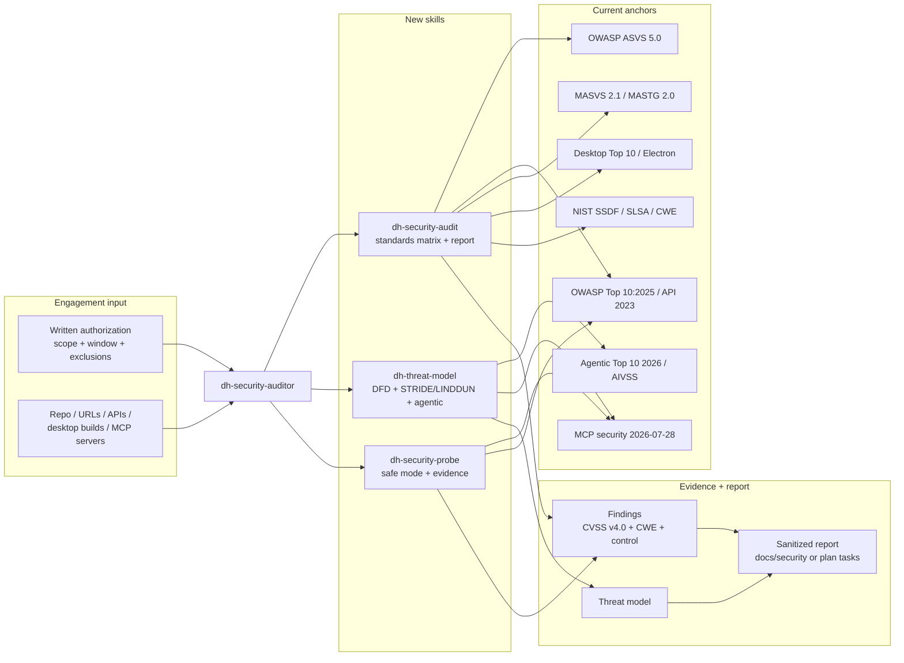

# Enterprise Security Auditor — Desired State

## Overview

One security auditor orchestrates three capabilities: standards-based audit,
architecture/agentic threat modeling, and authorized non-destructive probing.
Every finding is evidence-backed, mapped to a control, and reported with
remediation and re-test status.

## Key changes

- Security becomes a selectable capability, not only a review dimension.
- Standards versions and source links are pinned in a reference matrix.
- Active testing is impossible without authorization, scope and safe mode.
- Agentic/MCP surfaces get first-class threat modeling and probe playbooks.
