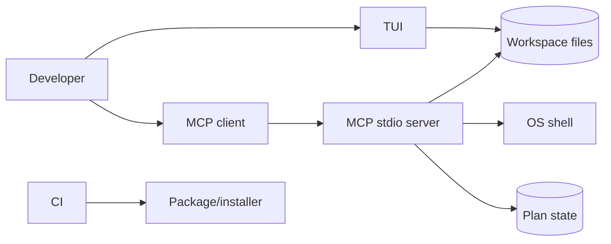

# Threat Model: dev-harness-skills

## Scope and assumptions

- **In scope:** local MCP stdio server, TUI plan read path, bundled agent/skill
  assets, installer/CI package pipeline.
- **Out of scope:** remote web/API services, mobile/desktop packaged apps,
  third-party MCP servers.
- **Assumptions:** OpenCode and its MCP client run as the developer's user;
  no multi-tenant or remote MCP transport is enabled.
- **Evidence:** `src/mcp/`, `src/tools/`, `src/tui/`, `scripts/lib/`,
  `docs/security/security-profile.md`.

## Assets

| Asset | Class | Why it matters |
|---|---|---|
| Workspace files | C/I | Plan/docs/source integrity |
| Plan status/index | I | Execution truth |
| Local shell | C/I/A | `dh_logged_command` runs as the server user |
| Developer credentials | C | Reachable by the server user |
| Bundled assets | I | Agent/skill behavior |

## Actors and entry points

| Actor | Capability | Entry point |
|---|---|---|
| Developer | full local user | OpenCode/TUI |
| MCP client | 12 tool calls | local stdio |
| Bundled agent | delegated tool use | plugin runtime |
| CI | build/package | GitHub Actions |

## Data flows and trust boundaries

- **B1:** OpenCode/TUI ↔ workspace files (local user, ACL/symlink checks).
- **B2:** MCP client ↔ local server (stdio, trusted local client).
- **B3:** MCP server ↔ OS shell (privileged capability; SEC-001).
- **B4:** CI ↔ published package (provenance, lockfile, scanner gates).

## STRIDE analysis

| Element | S | T | R | I | D | E |
|---|---|---|---|---|---|---|
| TUI file read | local user only | path traversal mitigated | local audit | plan data | local | no elevation |
| MCP plan tools | local client | status/path tamper | tool logs | plan data | low | path ACL |
| MCP shell tool | local client | arbitrary command | logs | credentials | local resource | server user (SEC-001) |
| Asset loader | frontmatter only | package tamper | git history | no code exec | low | no elevation |
| CI package | workflow identity | supply-chain tamper | CI logs | package | low | least privilege |

## Privacy (LINDDUN)

No personal data is processed by the plugin itself. Plan docs may contain
project data; reports must redact secrets/PII before publication.

## Agentic/MCP threats

| ID | Threat | Asset/boundary | Control status | Test idea |
|---|---|---|---|---|
| ASI02 | Tool misuse | MCP tools | partial: schemas/ACL; command tool privileged | negative tool-input tests |
| ASI03 | Identity/privilege abuse | local client → server user | partial: local-only trust | least-privilege run |
| ASI05 | Unexpected code execution | `dh_logged_command` | missing policy (SEC-001) | command confirmation test |
| MCP-01 | Confused deputy | no remote OAuth surface | not applicable | profile check |
| MCP-02 | Token passthrough | no upstream API tokens | not applicable | profile check |
| MCP-03 | SSRF/state handle | no remote fetch/session state | not applicable | profile check |
| MCP-04 | Local server compromise | stdio binary/package | partial: build/audit gates | supply-chain scan |

## Abuse cases

| Abuse case | Preconditions | Impact | Control |
|---|---|---|---|
| Prompt-injected command execution | agent has `dh_logged_command` | arbitrary local command | SEC-001 policy/least privilege |
| Plan status tampering | local client access | wrong orchestration state | local trust, tests |
| Path traversal via plan path | crafted slug/path | read outside plans | `resolvePlanPath`/symlink ACL |

## Prioritized threats

| ID | Likelihood | Impact | Priority | Owner |
|---|---|---|---|---|
| SEC-001 | medium | high | P2 | plugin maintainers |
| ASI04 supply chain | low | high | P2 | release/CI |
| Plan path tamper | low | medium | P3 | plugin maintainers |

## Accepted risks

| Risk | Rationale | Owner | Review date |
|---|---|---|---|
| Local MCP trust boundary | local developer tool; no remote transport | maintainers | 2027-02-17 |

## Handoff to audit

- Verify `dh_logged_command` policy/least-privilege guidance.
- Static-check plan path ACL/tests and asset loader.
- No authorized network probing for this repo.
