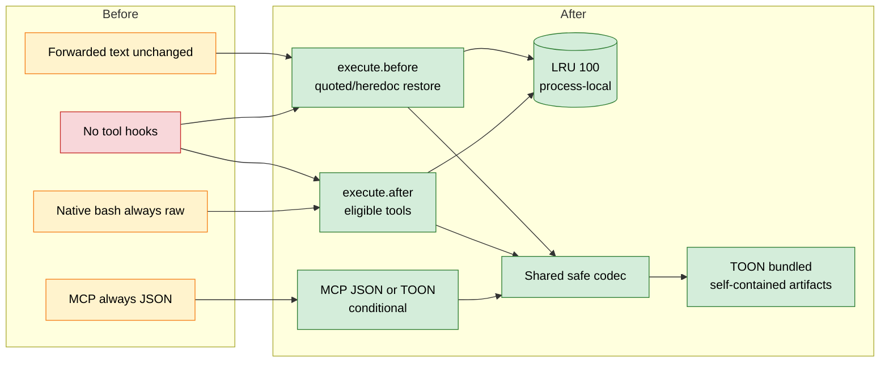

# TOON Output Integration — Critical Changes

## Overview

The risky changes are the automatic MCP format switch, the two host hooks, the
process-local cache boundary, and shell-safe restoration. Everything else is a
shared codec plus tests and docs.

**Legend:** green = new, amber = changed, red = removed.

## Notes

- Automatic MCP TOON is a text-format change, not a payload change.
- The plugin contract changes from “zero tool-domain access” to “two execute
  hooks, zero tool/command/prompt transforms.”
- Exact-match restoration is process-local; MCP TOON uses valid-TOON fallback.
- Shell restoration is limited to quoted strings and heredocs; unquoted text
  is never rewritten.

## Related

- [Plan](../plan.md) · [Diagram index](./index.md)
