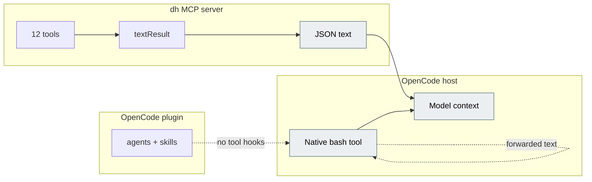

# TOON Output Integration — Current State

## Overview

Every MCP tool serializes its payload with `JSON.stringify` through
`textResult`; the native bash tool returns its output as plain text. Neither
surface compresses JSON, and a later bash command that forwards output receives
the original text unchanged.

## Notes

- MCP payloads are JSON even when the data is highly tabular.
- Native bash output is raw text; no JSON detection or TOON conversion.
- The plugin registers agents/skills only; it has no `execute.after` or
  `execute.before` hooks.
- Forwarded bash output is never rewritten to JSON.

## Related

- [Plan](../plan.md) · [Diagram index](./index.md)
