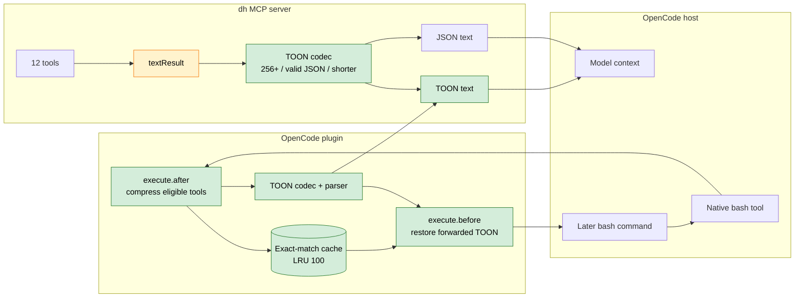

# TOON Output Integration — Desired State

## Overview

MCP results and eligible native tool output become TOON when the JSON is at
least 256 characters and TOON is shorter. The plugin remembers the original
JSON for native bash output and restores it when that TOON is forwarded into a
quoted string or heredoc.

## Notes

- MCP and native bash share the codec and thresholds but not the cache: the MCP
  server is a separate process.
- Native bash compression is limited to eligible tools (default `bash`, override
  `OPENCODE_TOON_PLUGIN_TOOLS`).
- Restoration scans only quoted strings and heredocs; edited/invalid payloads
  stay unchanged.
- JSON remains the canonical internal/on-disk format.

## Related

- [Plan](../plan.md) · [Diagram index](./index.md)
