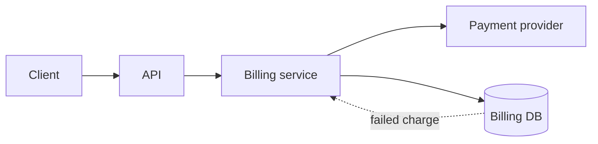
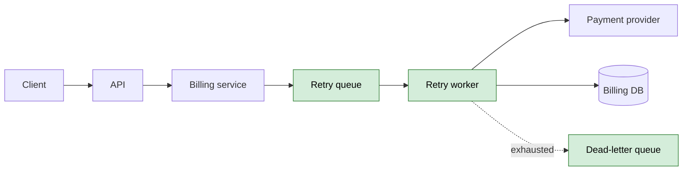
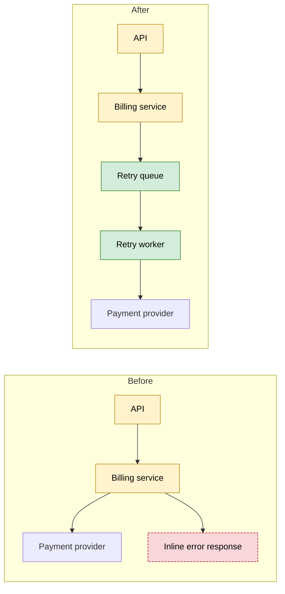
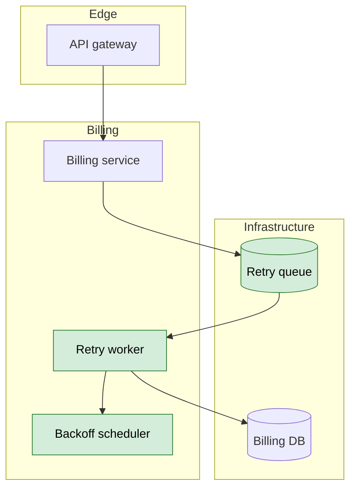

# Plan diagrams — contract and templates

Authoritative contract for `dh-mermaid` plan diagrams. `dh-planning` links them
from `plan.md` → `## Visual Context`; `dh-review` treats them as plan context, not scope.

## File layout

```text
docs/plans/<plan-slug>/
  plan.md
  diagrams/
    index.md            # required: index of every diagram
    current-state.md    # required when the plan has structural impact
    desired-state.md    # required when the plan has structural impact
    critical-changes.md # required for critical/high-risk modifications
    components.md       # required when components/boundaries change
    sequence.md, data-model.md, timeline.md  # optional: flows, data, phases
```

Write `None — no structural change` in `plan.md` → `## Visual Context` when there is no visual impact; never create an empty `diagrams/`.

## Frontmatter

Diagram files and `index.md` start with Obsidian frontmatter; only diagram files add `diagram_type`:

```yaml
---
title: <Plan title> — Current State
tags: [diagram, plan, mermaid]
project: <project>
created: <YYYY-MM-DD>
updated: <YYYY-MM-DD>
stack: <stack or "n/a">
feature: <feature or plan slug>
epic: <epic or plan slug>
diagram_type: flowchart
---
```

`created` set once; `updated` per edit. `diagram_type` (diagram files only)
matches the main block (`flowchart`, `sequenceDiagram`, `stateDiagram-v2`,
`erDiagram`, `C4Context`, `architecture-beta`, `gantt`, `timeline`); `project` matches the plan.

## File structure

Every diagram file is `# <title>` → `## Overview` (2–3 sentences) → one fenced
`mermaid` block → `## Notes` → `## Related` (plan diagrams: `../plan.md` +
`./index.md`; documentation diagrams: the parent document).

## index.md
`index.md` has frontmatter + the table only; no `diagram_type`, no Mermaid block.

````markdown
---
title: <Plan title> — Diagrams
tags: [diagram, plan, mermaid]
project: <project>
created: <YYYY-MM-DD>
updated: <YYYY-MM-DD>
stack: <stack or "n/a">
feature: <feature or plan slug>
epic: <epic or plan slug>
---

# <Plan title> — Diagrams

| Diagram | Purpose | Type | Link |
| --- | --- | --- | --- |
| Current state | How the system works today | flowchart | [current-state.md](./current-state.md) |
| Desired state | How it works after the plan | flowchart | [desired-state.md](./desired-state.md) |
| Critical changes | Changed/new/removed elements | flowchart | [critical-changes.md](./critical-changes.md) |
| Components | Component and dependency graph | flowchart | [components.md](./components.md) |
````

## Current state

Flowchart for components/data flow; state or ER when lifecycle/data dominate;
C4/architecture when the boundary is the point. Keep node IDs stable — the
desired state reuses them; this is the full exemplar.

````markdown
---
title: Billing retries — Current State
tags: [diagram, plan, mermaid]
project: billing
created: 2026-11-08
updated: 2026-11-08
stack: TypeScript, PostgreSQL
feature: billing-retries
epic: billing-reliability
diagram_type: flowchart
---

# Billing retries — Current State

## Overview
The API charges synchronously through the billing service; failed charges are
persisted but never retried.


## Notes
- No queue: provider latency sits on the request path.

## Related
- [Plan](../plan.md) · [Diagram index](./index.md)
````

## Desired state

Same scope and node IDs as `current-state.md`, plus target components marked `classDef new`, legend included.

````markdown
# Billing retries — Desired State

## Overview
Charges are queued and retried by a worker with backoff; the API no longer
waits on the provider.


## Notes
- `Retry queue`, `Retry worker`, and `Dead-letter queue` are new.
````

## Critical changes

One diagram makes the risky change obvious: `classDef changed`, `new`, and `removed`, legend under the block.

````markdown
# Billing retries — Critical Changes

## Overview
The synchronous charge path becomes asynchronous; provider failures no longer
return inline errors.



- `changed` — existing element whose behavior or contract changes
- `new` — element added by the plan
- `removed` — element deleted by the plan

## Notes
- Provider failures now return `202`; rollout ships the queue dark first.
````

## Components

Prefer C4/architecture when boundaries matter, block for modules, or flowchart
subgraphs as the portable fallback; experimental types degrade to flowchart.

````markdown
# Billing retries — Components

## Overview
Component view of the billing surface after the plan, including the new
asynchronous path.


## Notes
- C4/architecture variants: see `c4.md` and `architecture.md`.
````

## Optional diagrams

Optional: `sequence.md` (`sequenceDiagram`, `alt`/`else` failures), `data-model.md`
(`erDiagram`, added columns), `timeline.md` (`timeline`/`gantt`, phases/rollout).

## Selection matrix

| Concern | Recommended diagram | Reference |
| --- | --- | --- |
| Current state | Flowchart; state/ER when lifecycle/data dominate | [flowchart.md](./flowchart.md) |
| Desired state | Flowchart with `classDef new` | [flowchart.md](./flowchart.md) |
| Critical change | Flowchart before/after with legend | [flowchart.md](./flowchart.md) |
| Components | C4, architecture, block, or flowchart subgraphs | [c4.md](./c4.md) |
| Lifecycle | State diagram | [stateDiagram.md](./stateDiagram.md) |
| Data | ER diagram | [entityRelationshipDiagram.md](./entityRelationshipDiagram.md) |
| Timeline / phases | Gantt or timeline | [gantt.md](./gantt.md) |

## Rules

1. One concern per file; split instead of overloading a diagram.
2. Reuse node IDs between current and desired state so changes are visible.
3. Mark every changed, new, or removed element and include the legend.
4. Keep diagrams readable (~20 nodes); extract a second file when larger.
5. Link each diagram to the plan section or requirement IDs it explains.
6. No secrets, tokens, credentials, customer data, or full source code.
7. Validate with a renderer when available; else check header, subgraphs, statements.
8. Keep `index.md` complete — every diagram file is listed with type and link.

## Verification checklist

- [ ] `diagrams/index.md` exists and links every diagram file.
- [ ] Required files exist, or `None — no structural change` is explicit.
- [ ] Diagram files have complete frontmatter + matching `diagram_type`; `index.md` has frontmatter only.
- [ ] `plan.md` → `## Visual Context` links resolve.
- [ ] Current/desired state share node IDs; changes carry classes + legend.
- [ ] Every block uses the `mermaid` info string and renders (or is syntax-checked).
- [ ] No secrets, credentials, or full code inside diagrams.
- [ ] `## Related` links resolve.
