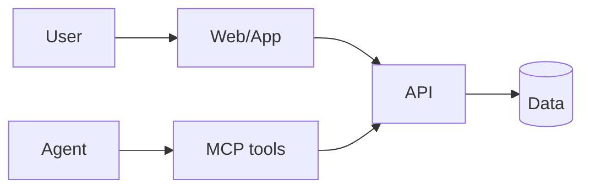

# Threat Model Template

```markdown
---
title: "Threat Model — <system>"
slug: <engagement>
tags: [security, threat-model]
project: "<project>"
created: YYYY-MM-DD
updated: YYYY-MM-DD
status: active
---

# Threat Model: <system>

## Scope and assumptions

- **In scope:** <services, clients, MCP servers, agents, data>
- **Out of scope:** <...>
- **Assumptions:** <...>
- **Evidence:** <repo paths, diagrams, deployment manifests>

## Assets

| Asset | Class | Why it matters |
|---|---|---|
| <data/service/capability> | C/I/A/safety | <...> |

## Actors and entry points

| Actor | Capability | Entry point |
|---|---|---|
| <user/service/agent/admin> | <...> | <...> |

## Data flows and trust boundaries



- **B1:** <boundary, controls, authn/authz>
- **B2:** <...>

## STRIDE analysis

| Element | S | T | R | I | D | E |
|---|---|---|---|---|---|---|
| <process/store/flow> | <threat or -> | ... | ... | ... | ... | ... |

## Privacy (LINDDUN, if personal data)

| Principle | Threat | Control |
|---|---|---|
| Linking | <...> | <...> |

## Agentic/MCP threats

| ID | Threat | Asset/boundary | Control status | Test idea |
|---|---|---|---|---|
| ASI01 | Goal hijack | <...> | <...> | <...> |
| MCP-01 | Confused deputy | <...> | <...> | <...> |

## Abuse cases and business logic

| Abuse case | Preconditions | Impact | Control |
|---|---|---|---|
| <...> | <...> | <...> | <...> |

## Prioritized threats

| ID | Likelihood | Impact | Priority | Owner |
|---|---|---|---|---|
| T-01 | <...> | <...> | P1 | <team> |

## Accepted risks

| Risk | Rationale | Owner | Review date |
|---|---|---|---|
| <...> | <...> | <...> | YYYY-MM-DD |

## Handoff to audit

- Controls to verify: <...>
- Probes to run (authorized only): <...>
- Open questions: <...>
```
