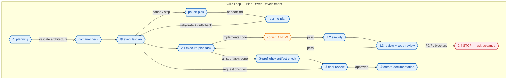

# Skills Index — dev-harness-skills plugin

> The plugin bundles **26 skills** (incl. `dh-grill-sdd` SDD interviewer,
> `dh-setup` harness setup, `dh-contingency` planning support, and
> `dh-pause-plan` / `dh-resume-plan` lifecycle support).
> Loading a skill injects its instructions and resources into the current
> conversation. Plans are **phased** (phases → sub-tasks, dual status
> markers); plan lifecycle is managed via the `dh` MCP server tools
> (`dh_plan_read`, `dh_plan_update_status`, `dh_plan_create` —
> see `docs/LOADING.md`). All plan execution follows the skills loop below.

## The skills loop (verbatim)

Plans are **phased**: `## Phases` → `### Phase N: <title>` (with `- **Status:**`)
→ `#### Sub-Task N.M: <title>` (with full fields + `- **Status:**`). Format
contract: `skills/dh-planning/references/phased-plan-template.md`.

1. `dh-planning` → use `dh-domain-check` while planning (creates phased plans)
2. `dh-execute-plan` (iterates phases in order → their sub-tasks)
   2.1 `dh-execute-plan-task` → use `dh-coding`
   2.2 `dh-simplify`
   2.3 `dh-review` + `dh-code-review`
   2.4 IF hard blockers → stop and ask guidance; otherwise keep `dh-execute-plan-task` loop
3. `dh-preflight` + `dh-artifact-check`
4. `dh-final-review` (reports per-phase completion)
5. `dh-create-documentation` (also writes the evolution and observation notes)

**Step 2.4 halts automation.** On a hard blocker (3 consecutive validation
failures, unresolved P0/P1 review findings, or missing preconditions), report
it and ask the user for guidance — never silently continue or mark sub-tasks
Complete around a blocker (see repo-root `AGENTS.md`). A blocked sub-task
blocks its phase.

**Pause/resume (cross-cutting).** Pause writes `docs/plans/<slug>/handoff.md`
with the active phase/sub-task, git state, decisions, blockers, validation, and
next steps without changing plan statuses. Resume validates the handoff,
detects drift, rehydrates context, marks it `resumed`, and re-enters step 2.
`dh-execute-plan` redirects when a paused handoff exists; it is not a fourth
status.

**Fast execution (alternative).** `dh-execute-plan-fast` runs the same phased
plan from `docs/plans/<slug>/plan_fast.md` with no per-task gates. Status is
mirrored to both `plan_fast.md` and `plan.md`, skipped checks are appended to
`plan_fast_skip_checks.md`, and the critical gates (alignment, simplify,
code-review, domain-check when architectural, preflight, artifact-check, final
review, docs, semver) run once across plan end. `dh-execute-plan-task-fast`
handles one sub-task; `dh_plan_fast_sync` + `dh-review` Plan Alignment Mode
verify mirror alignment.

**Plan lifecycle tools:** use `dh_plan_read` to parse a phased plan
(including each sub-task's `delegatedTo`), `dh_plan_update_status` to flip
phase/sub-task status markers, and `dh_plan_create` to scaffold a new plan
(passing `delegatedTo` for every sub-task) — fall back to direct plan.md edits
only when the tools are unavailable. These tools are exposed by the project-scope `dh` MCP server; under Code Mode they are called as `tools.dh.<tool>`, and `dh_<tool>` is the tool's normalized name (permission actions match `dh_*`).

## The 26 bundled skills

| Skill | Role in the loop |
|---|---|
| [`dh-planning`](dh-planning/SKILL.md) | Step 1 — write plans (`docs/plans/<slug>/plan.md`), interview mode |
| [`dh-domain-check`](dh-domain-check/SKILL.md) | During planning + before complex implementation — DDD/SOLID validation |
| [`dh-contingency`](dh-contingency/SKILL.md) | Planning support — generate Plan A/B/C alternatives with risk, complexity, and trade-off analysis (`docs/plans/<slug>/contingency.md`) |
| [`dh-execute-plan`](dh-execute-plan/SKILL.md) | Step 2 — orchestrate full plan execution, review each sub-task, resume mode |
| [`dh-execute-plan-fast`](dh-execute-plan-fast/SKILL.md) | Fast step 2 — execute from `plan_fast.md` with no per-task gates; critical gates at plan end, skipped-check ledger |
| [`dh-execute-plan-task`](dh-execute-plan-task/SKILL.md) | Step 2.1 — execute one sub-task (project-type-aware delegation) |
| [`dh-execute-plan-task-fast`](dh-execute-plan-task-fast/SKILL.md) | Fast step 2.1 — one sub-task from the mirror: dual-plan status + per-task ledger rows, no per-task gates |
| [`dh-pause-plan`](dh-pause-plan/SKILL.md) | Cross-cutting — snapshot the active plan into `handoff.md`; read-only pause, no status changes |
| [`dh-resume-plan`](dh-resume-plan/SKILL.md) | Cross-cutting — validate the handoff, detect drift, rehydrate context, and resume execution |
| [`dh-coding`](dh-coding/SKILL.md) | **NEW** — TDD best practices; reads `CODE_RULES.md` at project root |
| [`dh-execute-cli`](dh-execute-cli/SKILL.md) | Utility — execute commands, tests, builds, linters, and validation via the logged-command strategy (`dh_logged_command` or temp-log head/tail); compact reports |
| [`dh-explore`](dh-explore/SKILL.md) | Utility — codebase exploration with glob, grep, and targeted reads; compact evidence with exact file references |
| [`dh-code-query`](dh-code-query/SKILL.md) | Utility — query the code knowledge graph with code-graph-rag (`cgr`): definitions, callers/callees/importers, tests, dead code, duplicates; setup/indexing live in `dh-setup` |
| [`dh-simplify`](dh-simplify/SKILL.md) | Step 2.2 — reuse/quality/efficiency pass on changed code (software only) |
| [`dh-review`](dh-review/SKILL.md) | Step 2.3 — verify a sub-task against acceptance criteria |
| [`dh-code-review`](dh-code-review/SKILL.md) | Step 2.3 — code-level correctness/security/robustness review |
| [`dh-preflight`](dh-preflight/SKILL.md) | Step 3 — run full test/lint/static-analysis gate |
| [`dh-artifact-check`](dh-artifact-check/SKILL.md) | Step 3 — validate build artifacts + deploy scripts |
| [`dh-final-review`](dh-final-review/SKILL.md) | Step 4 — plan-level sign-off verdict |
| [`dh-create-documentation`](dh-create-documentation/SKILL.md) | Step 5 — generate/update project docs plus evolution + observation notes (vault = `{project_root}`, docs under `{project_root}/docs`) |
| [`dh-create-worktree`](dh-create-worktree/SKILL.md) | Cross-cutting — create/reuse/merge/remove worktrees following the project's `WORKTREE_LIFECYCLE.md`; generation delegated to `dh-setup` |
| [`dh-mermaid`](dh-mermaid/SKILL.md) | Planning + docs — Mermaid diagrams: current/desired state, critical changes, component graphs; plan output under `docs/plans/<slug>/diagrams/` |
| [`dh-grill-sdd`](dh-grill-sdd/SKILL.md) | Pre-planning — interviews the user and produces `./docs/plans/<slug>/sdd.md` (the requirements contract `dh-planning` consumes) |
| [`dh-setup`](dh-setup/SKILL.md) | Environment — audits system software (chrome/uv/nvm/osv-scanner/docker/jq/xq/yq/phpenv), user MCPs + plugins, and scaffolds project QA (hooks + stack tools) |
| [`dh-code-ruler`](dh-code-ruler/SKILL.md) | Rules — grills the user + analyzes code to generate `{project_root}/CODE_RULES.md` (style, patterns, security/perf constraints, stack best practices); run by the selected architecture agent |
| [`dh-semver`](dh-semver/SKILL.md) | Release — analyzes commits since the last tag, determines the version bump, generates a changelog, and creates a local tag (harness adaptation of the global `semver` skill) |

## Agents

The 5 bundled agents available as harness capabilities (see `AGENTS.md` →
Runtime delegation):

`dh-software-architect` (architecture, planning support) ·
`dh-software-engineer` (implementation, TDD coding) · `dh-reviewer` (review,
code-review) · `dh-final-reviewer` (final sign-off) · `dh-documentor`
(documentation owner).

Delegation is capability-based: skills resolve the architecture,
implementation, testing/QA, review, final-review, and documentation roles
against the current environment using
[`dh-planning/references/agent-selection.md`](dh-planning/references/agent-selection.md)
(runtime agent list → project config/agent directories → global definitions;
project-specific agents win over bundled fallbacks). `dh-planning` records the
chosen agents and generic fallbacks in the plan's `## Agent Selection` table;
execution re-validates them before delegating.

Command execution and codebase exploration are skill instruction layers
(`dh-execute-cli`, `dh-explore`), not selectable agents.

## Out of scope

Commands, prompts, and all other non-bundled harness content are
intentionally NOT bundled.